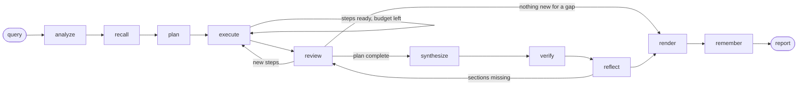

# ARA-1: Autonomous Financial Research Agent

Zetheta Project 1A. Author: Mohammad Baker Masri.

ARA-1 takes a research question about a public company, sector or market situation and writes a
cited investment research report. It plans the work, gathers data from SEC filings, market data,
earnings communications and the news, and resolves conflicting figures. Every figure in the report
is checked against the evidence behind it. The whole system runs at zero cost: every dependency and
data source is free, and no credit card is needed anywhere.

## Architecture at a glance

```
query -> query analysis -> plan -> execute steps (bounded ReAct, 12 tools) -> synthesis -> write -> verify -> report
              |                          |                    |
        ambiguity, scope           memory (Chroma,       claim ledger, source tiers,
                                   SQLite facts,         conflict protocol
                                   episodic lessons)
```

- **Agent loop** (`agent/`): a Plan-and-Execute graph (LangGraph) with a bounded ReAct executor per
  step, re-planning, verification and reflection.
- **Tools** (`tools/`): 12 tools with JSON schemas, argument validation, caching, evidence ids and
  a call log.
- **LLM client** (`agent/llm.py`): Gemini, then Groq, then Ollama, through the `openai` SDK.
- **Memory** (`memory/`): Chroma vector store, SQLite facts store, episodic lessons, prompt budgeting.
- **Synthesis** (`synthesis/`): claim ledger, source-tier weights, conflict resolution, narrative threads.
- **Resilience** (`agent/error_handler.py`, `agent/circuit_breaker.py`): per-class retries, one
  circuit breaker per data provider, fallback chains.
- **Evaluation** (`evaluation/`): 23 metrics (the 22 in the spec plus benchmark recall BM-1), an LLM judge, a dashboard, stress tests.

The full design is in [docs/architecture_specification_final.md](docs/architecture_specification_final.md).

The agent is a LangGraph state machine (`agent/core.py`, `_build_graph`):



## Requirements

- Python 3.11 or newer (`requires-python = ">=3.11"` in `pyproject.toml`; developed on 3.14).
- About 1 GB of free disk space for the dependencies and the embedding model.
- Windows, Linux or macOS. Development and testing were done on Windows 10. Only the venv
  activation command differs by system (see below).
- Internet access for live runs. Mock runs and the tests need none.

## Setup

1. Create and activate a virtual environment.

   | System | Create | Activate |
   |---|---|---|
   | Windows (PowerShell) | `python -m venv .venv` | `.venv\Scripts\Activate.ps1` |
   | Windows (Git Bash) | `python -m venv .venv` | `source .venv/Scripts/activate` |
   | Linux / macOS | `python3 -m venv .venv` | `source .venv/bin/activate` |

2. Install the dependencies.

   ```bash
   python -m pip install -r requirements.txt
   ```

   For the tests and lint, also run `python -m pip install pytest ruff`
   (or `python -m pip install -e ".[dev]"`).

3. Create your `.env` from the template and fill in the keys you have.

   ```bash
   cp .env.example .env        # Windows PowerShell: Copy-Item .env.example .env
   ```

   `.env` is git-ignored, so keys are never committed.

## API keys

All services are free and need no credit card. Without any LLM key, mock mode still works.

| Variable | Required? | Where to get it (free) | Without it |
|---|---|---|---|
| `GEMINI_API_KEY` | Recommended. Primary LLM. | <https://aistudio.google.com/apikey>: sign in, click Create API key. | Gemini is skipped; the client tries Groq, then Ollama. |
| `GROQ_API_KEY` | Optional. Backup LLM (two Groq models share this one key). | <https://console.groq.com/keys> | Groq is skipped; the client tries Ollama. |
| Ollama (no key) | Optional. Offline last resort. | Install from <https://ollama.com>, then `ollama pull qwen2.5:3b` (about 2 GB). | If no provider is reachable, a live run cannot call an LLM. |
| `SEC_CONTACT_EMAIL` | Required for live SEC data. This is an email address, not a key. | Any email you read. The SEC asks for a contact address in the User-Agent of every EDGAR request. No account needed. | Live SEC EDGAR and XBRL tools do not work. Mock mode is unaffected. |
| `OPENAI_API_KEY`, `ANTHROPIC_API_KEY` | Not needed. Paid providers, off by default. | Only used if you add them to `ARA_PROVIDER_ORDER`. | Nothing changes. |

Fallback chain: Gemini, then Groq, then Ollama. A provider whose key is missing is skipped. If a
provider fails or hits its quota, the client moves to the next one. Live data sources (yfinance,
Google News, web search) need no keys.

Optional run settings (all in `.env.example`, defaults in [config/default.toml](config/default.toml)):

| Variable | Values | Meaning |
|---|---|---|
| `ARA_MODE` | `mock`, `local`, `free` (default) | `mock`: scripted LLM and mock data, no network. `local`: Ollama only. `free`: Gemini, Groq, Ollama. |
| `ARA_DATA_MODE` | `mock`, `live` | Tool data source, independent of the LLM. |
| `ARA_PROVIDER_ORDER` | e.g. `gemini,groq,groq_qwen,ollama` | Provider order. |
| `ARA_GEMINI_MODEL`, `ARA_GROQ_MODEL`, `ARA_GROQ_QWEN_MODEL`, `ARA_OLLAMA_MODEL` | model names | Override a model. |
| `ARA_GEMINI_REASONING_EFFORT` | e.g. `minimal` | Gemini thinking budget. |
| `ARA_LOG_LEVEL` | `INFO`, `DEBUG`, ... | Log level. |

## Check your setup

```bash
python -m config.doctor              # full check, including a live call to each LLM provider
python -m config.doctor --offline    # skip network checks
python -m config.doctor --provider gemini
python -m config.doctor --json       # machine-readable output
```

The doctor checks the Python version, packages, `.env`, settings, the tool registry and the vector
database. For each LLM provider it checks that the model exists, answers a prompt and completes a
tool-call round trip. It says how to fix anything missing and never prints key values.

## Quick start

All commands run from the repository root with the venv active.

**1. Mock run (no keys, no network):**

```bash
python -m agent "Create a comprehensive profile of Microsoft Corporation" --mode mock --data mock --out report.md
```

**2. Live run (needs the keys above):**

```bash
python -m agent "Create a comprehensive profile of Microsoft Corporation" --out report.md
```

Options of `python -m agent`:

| Option | Meaning |
|---|---|
| `--out FILE` | Write the report to this file (default: print it). |
| `--mode {mock,local,free}` | Override `ARA_MODE`. |
| `--data {mock,live}` | Override `ARA_DATA_MODE`. |
| `--max-seconds N` | Wall-clock limit (default 300). |
| `--fail-rate R`, `--fail-seed S`, `--fail-tools a,b` | Inject tool failures to test recovery. |

Responses are cached under `data/cache/`, so repeat research is faster. Each run prints a summary
line and writes a full trace to `traces/session-<time>-<id>.jsonl`.

**3. The eight challenges:**

```bash
python -m evaluation.runner                      # C1..C8, live data (about 45 s pause between runs)
python -m evaluation.runner C1 C4 --pause 30     # a subset
python -m evaluation.runner --data mock --pause 0
```

Each run is saved as a bundle in `results/runs/C<n>.json`, and the report as `results/challenge_<n>.md`.

| Id | Challenge |
|---|---|
| C1 | Single-company profile |
| C2 | Earnings analysis |
| C3 | Risk assessment |
| C4 | Industry comparison |
| C5 | Contradictory data handling |
| C6 | Ambiguous query handling |
| C7 | Sector analysis with memory |
| C8 | Full research report with degradation (50% injected tool failures) |

**4. Evaluation:**

```bash
python -m evaluation.evaluate                    # score bundles, run the judge, write dashboard and report
python -m evaluation.evaluate --ids C1 C4 --no-judge
python -m evaluation.dashboard                   # re-render dashboard and report from results/eval/scores.json
python -m evaluation.stress                      # concurrency, context and outage stress tests
```

Outputs: `results/eval/scores.json`, `results/evaluation_dashboard.html`,
`results/evaluation_report.md`. The judge uses the free LLM chain; `--no-judge` skips it.

**5. View a trace:**

```bash
python -m agent.trace_viewer traces/<session>.jsonl
```

The trace viewer is new on Day 14. See [docs/trace_gallery.md](docs/trace_gallery.md) for examples.

## Tests and lint

```bash
python -m pytest                    # about 650 tests, no network or keys needed (network tests are deselected)
python -m pytest -p no:cacheprovider -W ignore
ruff check .                        # lint, including docstring checks (D1) on source code
```

## Project layout

```
agent/        agent loop (core.py), LLM client, tracing, query analysis, error handling,
              circuit breakers, fallback chains, trace viewer
tools/        tool registry, 12 JSON tool schemas (tools/schemas/), tool implementations
memory/       Chroma vector store, chunking, facts store, episodic memory, context manager
synthesis/    claim ledger, conflict resolution, narrative threads
evaluation/   challenge runner, metrics, judge, dashboard, stress tests, token analysis
config/       default.toml, settings loader, environment doctor
docs/         architecture specification, trace gallery, evaluation report, optimisation log
results/      challenge outputs, run bundles, scores, dashboard
tests/        pytest suite
```

## Documents

| Document | Purpose |
|---|---|
| [docs/architecture_specification_final.md](docs/architecture_specification_final.md) | The final design: cognitive loop, tools, memory, synthesis, error handling, evaluation |
| [docs/architecture_diagram.svg](docs/architecture_diagram.svg) | Architecture diagram |
| [docs/trace_gallery.md](docs/trace_gallery.md) | Annotated example traces |
| [docs/evaluation_report_final.md](docs/evaluation_report_final.md) | Final evaluation of the eight challenges |
| [docs/optimization_log.md](docs/optimization_log.md) | Each optimisation with before/after numbers |
| [ERROR_LOG.md](ERROR_LOG.md) | The 7 deliberate errors found in the project document |
| [results/](results/) | Challenge reports, run bundles, scores, dashboard, stress and token reports |
| [tools/schemas/](tools/schemas/) | The 12 tool definitions (OpenAI function format plus `x-ara` metadata) |

## Status by day

| Day | Component | Status |
|---|---|---|
| 1 | Architecture specification and diagram, error log | Done |
| 2 | Tool registry (12 tools), schema validation, argument repair, caching, evidence ids, call log; local tools `calculation_engine`, `fact_checker`, `report_generator` | Done |
| 3 | LLM client (Gemini, Groq, Ollama; retries, reasoning-token accounting, tracing); Chroma long-term memory with local embeddings | Done |
| 4 | Hybrid agent loop: Plan-and-Execute graph with bounded ReAct executor, re-planning, verification of cited figures, reflection | Done |
| 5 | Live data tools: `sec_filing_search`, `financial_data_api` (SEC XBRL, restatement detection, yfinance backup), `web_search`, `news_sentiment`; rate-limited, disk-cached | Done |
| 6 | Memory: chunking per source type, SQLite facts store, episodic lessons, prompt budgeting | Done |
| 7 | Remaining network tools: `company_profile`, `earnings_transcript`, `peer_comparison` | Done |
| 8 | Synthesis: claim ledger, source-tier weights, conflict protocol, narrative threads | Done |
| 9 | Error handling: error taxonomy, retries, circuit breakers, fallback chains, failure injection (`--fail-rate`) | Done |
| 10 | Query analysis: type, complexity, ambiguity score, documented assumptions, private-company and recent-IPO flags | Done |
| 11 | Evaluation: 23 metrics (22 + BM-1), LLM judge, dashboard | Done |
| 12 | Challenge runs, stress tests, token usage analysis | Done |
| 13 | Optimisation: one schema per execute call, per-provider synthesis budget, deterministic review, section-targeted memory recall; see [docs/optimization_log.md](docs/optimization_log.md) | Done |
| 14 | Final documentation: technical README, final architecture specification, trace gallery, final evaluation report, trace viewer, docstrings enforced by ruff | Done |

## Use of AI tools

Following the project's AI Assistance Policy (E5.3), the AI tools used in this project are listed
below.

| Tool | Used for |
|---|---|
| Claude Code (Anthropic) | Drafting the architecture specification, diagram and error log; implementing and testing code. All output is reviewed and validated against the project requirements. |
