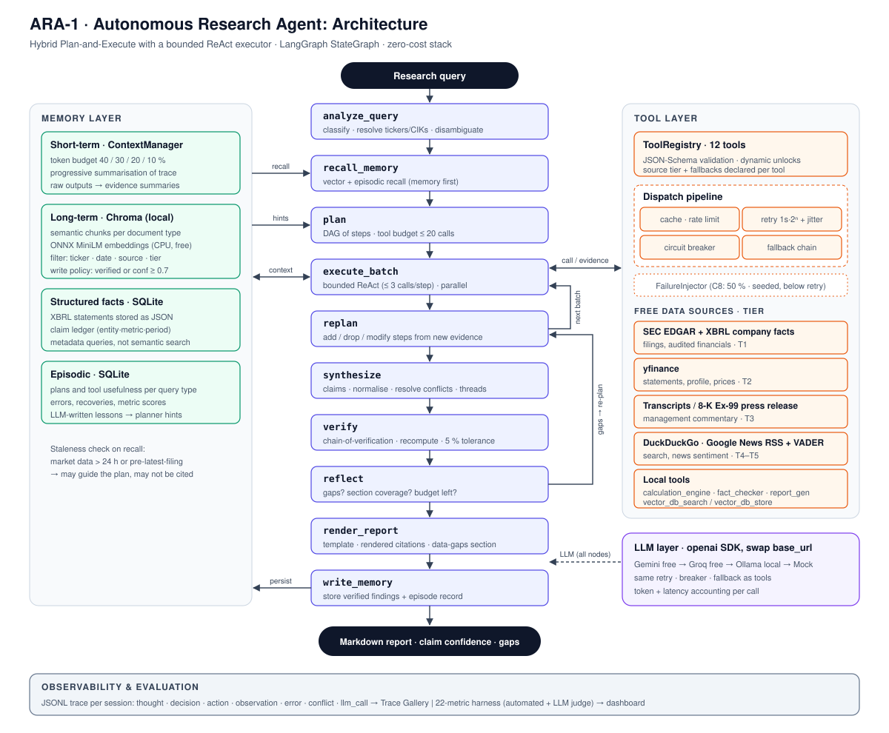

# ARA-1: Autonomous Financial Research Agent

ARA-1 is an autonomous agent that takes a research question about a public company and writes a
cited investment research report. It plans the research, gathers data from SEC filings, market
data, earnings communications and the news, and resolves conflicting figures along the way. It
needs no step-by-step guidance.

Zetheta Project 1A · Mohammad Baker Masri

> **Status: Day 6.** Done so far:
> - the architecture specification;
> - the tool registry (12 tools);
> - configuration, the LLM client with its provider fallback chain, the Chroma vector store, and
>   tracing;
> - the agent loop, which runs Challenge 1 end to end ([sample report on mock data](results/dev/day04_challenge1_mock.md));
> - live data: SEC EDGAR filings, SEC XBRL financials (yfinance as backup), web search and Google News sentiment;
> - memory: semantic chunking into Chroma, a structured facts store, episodic lessons, and prompt budgeting.

**Runs at zero cost.** Every dependency and data source is free, and no credit card is required
anywhere.

## What is built and what is planned

| Component | Status |
|---|---|
| **Tool registry**: 12 tools, schema validation, repair of common LLM argument mistakes, caching, evidence ids, call log | Built (Day 2) |
| **Local tools**: `calculation_engine`, `fact_checker`, `report_generator` | Built (Day 2) |
| **Live data tools**: `sec_filing_search` (EDGAR, 10-K items and risk factors), `financial_data_api` (SEC XBRL, restatement detection, yfinance backup), `web_search` (Brave/Bing/DuckDuckGo, Google News fallback), `news_sentiment` (Google News + finance-tuned VADER); rate-limited and disk-cached | Built (Day 5) |
| **Remaining network tools**: `company_profile` (EDGAR + yfinance), `earnings_transcript` (Motley Fool call transcripts split into prepared remarks and Q&A, 8-K press release as fallback), `peer_comparison` (yfinance industry peers or caller-chosen peers, SEC XBRL metrics) | Built (Day 7) |
| **LLM client**: Gemini → Groq → Ollama through the `openai` SDK, with retries, reasoning-token accounting and tracing. Verified against the live Gemini API. | Built (Day 3) |
| **Long-term memory**: Chroma with local embeddings | Built (Day 3) |
| **Hybrid agent loop**: a Plan-and-Execute graph (LangGraph) with a bounded ReAct executor per step, re-planning, verification of every cited figure, reflection | Built (Day 4) |
| **Memory**: chunking per source type (one chunk per risk factor, Q&A pairs kept together); financial statements in a SQLite facts store; episodic lessons fed to the planner; prompts fitted to a token budget (40/30 primary/supporting); Challenge 7 recalls earlier research | Built (Day 6) |
| **Synthesis**: a claim ledger (entity, metric, fiscal period, unit, evidence, confidence), configurable source-tier weights, the A6.3 conflict protocol (restatement, triangulated majority, highest tier, unresolved range) with a conflicts table in the report, and narrative threads (growth, margins, peers, news sentiment vs fundamentals) handed to the writer as a brief | Built (Day 8) |
| **Error handling**: an error taxonomy with per-class retries and exponential backoff, one circuit breaker per data provider (stops research when several are down), fallback chains with at least two alternatives per network tool, gaps and fallback use stated in the report, and seeded failure injection (`--fail-rate`) | Built (Day 9) |
| **Query analysis**: query type, complexity and a scored ambiguity level with its reasons; for ambiguous requests, documented assumptions (e.g. "the banks" = six largest US banks) and the questions it would have asked; flags for private companies, recent IPOs and fast-changing situations (M&A, leadership changes, restatements) | Built (Day 10) |
| **Evaluation**: 22 metrics, LLM judge, dashboard | Day 11 |

The full design is in the [architecture specification](docs/architecture_specification.md).

## Setup

### 1. Prerequisites

- **Python 3.11 or newer** (developed on 3.14).
- **Git.**
- About 1 GB of free disk space for the dependencies and the embedding model.

### 2. Install

```bash
git clone <this repository>
cd Project1A-MohammadBakerMasri-AutonomousFinancialResearchAgent
python -m venv .venv
```

Activate the environment:

| System | Command |
|---|---|
| Windows (PowerShell) | `.venv\Scripts\Activate.ps1` |
| Windows (Git Bash) | `source .venv/Scripts/activate` |
| macOS / Linux | `source .venv/bin/activate` |

Then install the dependencies:

```bash
python -m pip install -r requirements.txt
```

### 3. Configure

```bash
cp .env.example .env
```

Open `.env` and fill in the following. `.env` is git-ignored, so your keys never get committed.

| Variable | Required? | How to get it (all free, no card) |
|---|---|---|
| `GEMINI_API_KEY` | Recommended: the primary LLM | Sign in at <https://aistudio.google.com/apikey> with a Google account, then click **Create API key** |
| `GROQ_API_KEY` | Optional: backup LLM | Create an account at <https://console.groq.com/keys> and create a key |
| `SEC_CONTACT_EMAIL` | Required from Day 5 | Any email you read. The SEC requires a contact address in the User-Agent of every EDGAR request; no account is needed |

**Optional: an offline LLM with Ollama.** Install it from <https://ollama.com>, then run
`ollama pull qwen2.5:3b` (about 2 GB). ARA-1 falls back to it automatically when the cloud providers
are unavailable. Run with `ARA_MODE=local` to use only Ollama.

### 4. Check the setup

```bash
python -m config.doctor
```

The doctor checks the following, and says how to fix anything that is missing:

- the Python version and installed packages;
- your `.env` file and which keys are set (it never prints key values);
- the configuration;
- the tool registry;
- the vector database. The embedding model, about 80 MB, is downloaded once on the first run.

For each LLM provider it also checks that:

- the model exists;
- the model answers a prompt;
- it accepts ARA-1's real tool schemas and completes a tool-call round trip.

Use `--offline` to skip the network checks.

### 5. Run a research task

```bash
python -m agent "Create a comprehensive profile of Microsoft Corporation" --data mock --out report.md
```

`--data live` (the default) uses the free live sources; `--data mock` uses canned data; `--mode mock`
needs no network at all. Responses are cached under `data/cache/`, so repeat research on a company is
fast. The first download of a large 10-K can take minutes on a slow connection. Every run writes a full trace to `traces/`.

### 6. Run the tests

```bash
python -m pytest
```

The tests need no network access and no API keys.

## Run modes

Set these in `.env` or as environment variables. Defaults live in [config/default.toml](config/default.toml).

| `ARA_MODE` | LLM | Data | Use |
|---|---|---|---|
| `mock` | Scripted mock | Mock fixtures | Tests, and demos with no network |
| `local` | Ollama only | Live | Offline or unlimited development |
| `free` *(default)* | Gemini → Groq → Ollama | Live | Challenge runs |

`ARA_DATA_MODE=mock|live` overrides the data source independently of the LLM. The live data tools
arrive on Day 5; until then, keep `ARA_DATA_MODE=mock`.

## Project layout

```
agent/        reasoning loop (Day 4), LLM client (llm.py), tracing (tracing.py)
tools/        tool registry, 12 JSON tool schemas, tool implementations
memory/       vector store (Chroma); context manager and episodic memory (Day 6)
synthesis/    claim ledger, conflict resolution, narrative (Day 8)
evaluation/   metrics, benchmarks, dashboard (Day 11)
config/       default.toml, settings loader, environment doctor
docs/         architecture specification and diagram
results/      challenge outputs
tests/        pytest suite
```

## Documents

| Document | Purpose |
|---|---|
| [docs/architecture_specification.md](docs/architecture_specification.md) | The full design: cognitive loop, tools, memory, synthesis, error handling, evaluation |
| [docs/architecture_diagram.svg](docs/architecture_diagram.svg) | Architecture diagram |
| [ERROR_LOG.md](ERROR_LOG.md) | The 7 deliberate errors found in the project document |
| [tools/schemas/](tools/schemas/) | The 12 tool definitions (OpenAI function format plus `x-ara` metadata) |



## Use of AI tools

Following the project's AI Assistance Policy (E5.3), the AI tools used in this project are listed
below.

| Tool | Used for |
|---|---|
| Claude Code (Anthropic) | Drafting the architecture specification, diagram and error log; implementing and testing code. All output is reviewed and validated against the project requirements. |
