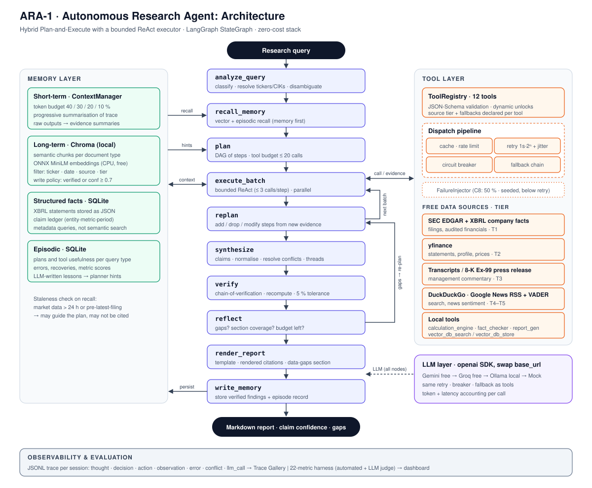

# ARA-1 — Agent Architecture Specification

**Project:** 1A — Autonomous Financial Research Agent with Multi-Source Synthesis
**Author:** Mohammad Baker Masri
**Version:** 0.1 (Day 1 draft; the final version will be `architecture_specification_final.md` on Day 14)
**Status:** Design baseline for the build phase (Days 2–10)

---

## Table of Contents

1. Purpose and Scope
2. Design Constraints
3. Requirements Traceability
4. Research Principles
5. Choice of Agent Pattern
6. System Overview
7. The Cognitive Loop
8. LLM Layer
9. Tool Registry
10. Memory Architecture
11. RAG Pipeline
12. Multi-Source Synthesis Engine
13. Verification and Hallucination Control
14. Error Handling and Graceful Degradation
15. Query Analysis and Disambiguation
16. Observability and Auditability
17. Evaluation Framework
18. Challenge Strategy
19. Configuration and Run Modes
20. Extensibility Toward Multi-Agent
21. Risks and Open Questions
22. Build Schedule

---

## 1. Purpose and Scope

ARA-1 is an autonomous research agent that does the work of a junior sell-side or buy-side analyst. It
takes a natural-language research request and produces a professional investment research report in
Markdown. It needs no step-by-step human guidance. Every factual claim in the report traces to a
retrieved source and carries a confidence score.

**In scope**

- US-listed public companies. The agent works from SEC filings, market data, earnings communications,
  news and web search.
- Eight report types, matching the eight challenges: company profile, earnings analysis, risk
  assessment, industry comparison, contradiction investigation, ambiguous-query analysis, memory-driven
  thematic analysis, and a full report produced while tools are failing.
- Reproducible runs, full reasoning traces, and automatic scoring on 20+ quality metrics.

**Out of scope for 15 days**

- Investment recommendations. The system prompt forbids them (spec A7.1, constraint 5).
- Real-time trading data and intraday analytics.
- A full multi-agent system (that is Project AAI-3B). Section 20 describes how the interfaces are kept
  ready for it.
- Non-US regulators. The tool registry can take SEBI/MCA tools later (spec C4.3), but none are built now.

## 2. Design Constraints

The following constraints shape almost every decision in this document.

| Constraint | Consequence |
|---|---|
| **Zero budget**: no paid APIs and no credit card on file | The LLM is Google Gemini's free tier, falling back to Groq's free tier and then a local Ollama model. All data sources are free: SEC EDGAR, SEC XBRL, yfinance, DuckDuckGo, Google News RSS. Embeddings are computed locally. |
| **Free-tier rate limits** | Every external call goes through a token-bucket limiter and a response cache. The planner minimises LLM calls, and memory is checked before any external API is called. |
| **Modest local hardware** (16 GB RAM, 4 GB GPU) | Only small local models (3–4B) are practical, so the local model is a fallback, not the primary. Embeddings use an ONNX MiniLM model on the CPU. |
| **Maximum of 20 tool calls per task** (A7.1) | The planner has to be efficient, and a tool-call budget is enforced in the graph state. |
| **Latency under 5 minutes** for single-company analysis (AB-5) | Independent plan steps run concurrently, and cached results are reused. |
| **Hallucination rate under 2%**, numerical accuracy above 98% | A claim ledger, forced citations, post-generation verification, and figures computed in code rather than by the LLM. |

## 3. Requirements Traceability

| Spec requirement | Where it is met | Module(s) |
|---|---|---|
| ReAct or Plan-and-Execute loop (Task, A1.3–A1.4) | Hybrid: a Plan-and-Execute outer graph with a bounded ReAct executor inside it | `agent/core.py` |
| ≥10 tools with OpenAI-style schemas (A2.2, A2.4) | 12 tools, each a JSON Schema in `tools/schemas/` | `tools/` |
| Tool selection that avoids the anti-patterns (A2.3) | Memory-first policy, context check before each call, budget accounting | `agent/prompts.py`, `agent/core.py` |
| Three-layer memory (A3) | Short-term context manager, Chroma long-term store, SQLite episodic store (plus a structured facts store) | `memory/` |
| Semantic chunking per document type (A3.3) | Chunkers for filings, transcripts, news and statements | `memory/vector_store.py` |
| Retries with backoff and jitter (A4.3) | 1s × 2ⁿ, at most 5 retries, 0–500 ms jitter | `agent/error_handler.py` |
| Fallback chains, at least 2 per tool (A4.3, Day 9) | A declarative chain table | `agent/fallback_chains.py` |
| Circuit breaker (Day 9) | A breaker per provider with closed, open and half-open states | `agent/circuit_breaker.py` |
| Fact-verification pipeline with a 5% tolerance (A4.3) | Claim extraction, tracing, cross-checking and confidence scoring | `tools/fact_checker.py`, `synthesis/` |
| Graceful degradation (A4.3) | A "Data Gaps & Limitations" section that is always rendered | `tools/report_gen.py` |
| Source reliability hierarchy (A6.2) | Configurable tier weights. The spec's Tier 4/5 order is corrected; see ERROR_LOG #2 | `synthesis/conflict_resolver.py` |
| Conflict-resolution protocol (A6.3) | The six-step resolver | `synthesis/conflict_resolver.py` |
| Narrative threading, triangulation, sentiment-fact alignment (A6.4) | Synthesis engine passes | `synthesis/engine.py`, `synthesis/narrative.py` |
| Six-stage RAG pipeline (A8) | Section 11 of this document | `memory/`, `synthesis/`, `agent/` |
| Query disambiguation (A7.3) | Query analyser plus a disambiguation module | `agent/query_analyzer.py`, `agent/disambiguation.py` |
| Dynamic tool unlocks with no code changes (B4.4) | Tools registered at runtime from config and unlock rules | `tools/tool_registry.py` |
| 20+ evaluation metrics (A5.2) | 22 metrics, automated and LLM-judged | `evaluation/metrics.py` |
| Trace gallery (B4.3) | JSONL traces and an annotation tool | `docs/trace_gallery.md` |

## 4. Research Principles

Following the Bridgewater case study (C5.2), ARA-1's behaviour is governed by explicit principles.
Each principle is a rule written into the prompt, and where possible it is also a check the code
enforces. Relying on the LLM's implicit judgement is not enough.

| ID | Principle | Enforced by |
|---|---|---|
| P1 | No number without a source. Every figure in the report cites evidence (`[E12]`). | The report renderer rejects uncited numbers, and verification flags them. |
| P2 | Numbers are computed, not generated. Growth rates, margins and ratios come from `calculation_engine`, never from LLM arithmetic. | The synthesis prompt, and the verifier recomputing derived figures. |
| P3 | Check memory before external APIs. | The graph always runs `memory_recall` before planning. |
| P4 | Prefer structured sources for structured data: XBRL or financial statements before web search. | Tool descriptions, plus fallback ordering. |
| P5 | Characterise growth only relative to a baseline. "Strong growth" requires beating the peer or industry median. | A post-generation rule in the verifier (C5.2 example). |
| P6 | Every conflict is shown in the report. | The resolver writes a conflict record, and the report renders a conflict table. |
| P7 | Name gaps, never fill them. | A degradation section is mandatory, and fallback confidence penalties are applied. |
| P8 | Keep facts and inferences apart. Inferences are labelled "Analysis:" and cite the facts they rest on. | The report template, and the LLM judge for CS-1. |
| P9 | Every figure has a period. Fiscal periods are always stated explicitly (e.g. "FY2025, ended 26-Jan-2025"). | Claims carry a `Period` object, and the renderer formats it. |
| P10 | No investment recommendation. | The system prompt, and an output filter for "buy/sell/hold". |

## 5. Choice of Agent Pattern

### 5.1 Options considered

| Pattern | Strengths | Weaknesses for this project |
|---|---|---|
| Pure ReAct | Adapts after every observation, simple to build | Makes too many tool calls, since each step is chosen in isolation. Hard to keep within 20 calls. The trace grows without bound, which overflows context (case study C3). |
| Pure Plan-and-Execute | Efficient and reviewable, and independent steps can run in parallel | Rigid when early findings change the picture (the A1.4 example of segment restructuring). |
| **Hybrid: plan, execute with a bounded ReAct, re-plan** | Planning is efficient and auditable, each step can still adapt locally, and re-planning handles surprises | Harder to build than either pure pattern |

### 5.2 Decision

**Hybrid.** A Planner produces a **dependency graph of research steps**, not just a list. Each step
names the information it needs, the preferred tool, the expected output, and which steps it depends
on. An Executor runs each step as a small ReAct loop capped at 3 tool calls. It can switch tools,
retry, or accept a fallback, but it can't leave the step's scope. After each batch of steps, a
Re-planner looks at what came back and may add, drop or modify steps.

This is the pattern the successful redesign in case study C3.3 used. It fits the free-tier
constraint because planning takes one LLM call instead of one per step, and independent steps run
concurrently.

### 5.3 Implementation substrate

The outer loop is a **LangGraph `StateGraph`** (spec E1.2). This gives explicit nodes, conditional
edges, and checkpointing, so a long Challenge 8 run can resume after a crash. Each node is a plain
Python function over a typed state, so nodes can be unit-tested without an LLM. Model calls go
through ARA-1's own `LLMClient` (Section 8) rather than LangChain's model wrappers. That keeps the
provider fallback chain and token accounting under our control.

## 6. System Overview



The system has five layers:

1. **Agent graph (orchestration).** Query analysis → memory recall → plan → execute ⇄ re-plan →
   synthesise → verify → reflect → report → memory write.
2. **Tool layer.** A registry of 12 tools behind one dispatch pipeline (validate → cache → rate-limit
   → retry → circuit breaker → fallback chain). All data sources are free.
3. **Memory layer.** Short-term context manager, long-term vector store (Chroma), a structured facts
   store (SQLite), and episodic memory (SQLite).
4. **Synthesis and verification.** The claim ledger, normalisation, conflict resolution,
   triangulation, narrative threading and fact checking.
5. **Cross-cutting.** The LLM layer with provider fallback, the trace logger, the evaluation harness,
   and configuration.

## 7. The Cognitive Loop

### 7.1 Graph

```
analyze_query → recall_memory → plan → execute_batch ─┬─(steps remain)──→ replan → execute_batch
                                                      └─(plan done)──→ synthesize → verify → reflect
reflect ─┬─(gaps & budget left)──→ replan
         └─(good enough or budget spent)──→ render_report → write_memory → END
```

**Nodes**

| Node | Input | What it does | Output (state updates) |
|---|---|---|---|
| `analyze_query` | raw query | Classifies the query type, resolves entities to tickers and CIKs, scores ambiguity, and settles fiscal-period references. When ambiguity is high it calls the disambiguation module (Section 15). | `query_profile`, `assumptions[]`, `clarifying_questions[]` |
| `recall_memory` | query profile | Searches the vector store for prior findings on these entities, and episodic memory for strategies that worked on this query type. | `recalled_evidence[]`, `strategy_hints[]` |
| `plan` | profile, hints, available tools | One LLM call returning a JSON plan: steps with `id`, `goal`, `tool`, `args`, `depends_on`, `expected_output` and `priority`. The plan is checked against the schema and the tool budget. | `plan` |
| `execute_batch` | ready steps (dependencies met) | Runs independent steps concurrently. Each step is a bounded ReAct loop of at most 3 calls. Every tool result becomes `Evidence` with provenance. | `evidence[]`, `step_status{}`, `tool_calls` counter |
| `replan` | plan, new evidence | Decides whether to add, drop or modify steps. This is where "the agent adjusts rather than fails". | revised `plan` |
| `synthesize` | evidence | Extracts claims, normalises them, resolves conflicts, triangulates, aligns sentiment with facts, builds narrative threads, and drafts each section with citations. | `claims[]`, `conflicts[]`, `draft_sections{}` |
| `verify` | draft, evidence | Chain-of-verification: checks every numeric and entity claim against the evidence, recomputes derived figures, and applies principle rules (P5, P10). | `verification_report`, corrected draft |
| `reflect` | verified draft | Self-reflection (A7.2): names weak sections, low-confidence claims and gaps against the template, and decides whether another research pass is worth the remaining budget. | `gaps[]`, `continue_research: bool` |
| `render_report` | verified draft | Renders the Markdown report from the template, with the methodology notes, the conflict table and the data-gaps section. | `report_md` |
| `write_memory` | report, evidence, trace | Chunks and stores verified findings, and records the episode (plan, tools, outcomes, errors and recoveries). | persisted state |

### 7.2 State schema

```python
class ResearchState(TypedDict):
    session_id: str
    query: str
    query_profile: QueryProfile          # type, entities, periods, ambiguity score
    assumptions: list[str]               # documented disambiguation assumptions
    plan: Plan                           # DAG of PlanStep
    evidence: dict[str, Evidence]        # evidence_id -> Evidence (with provenance)
    claims: list[Claim]                  # normalised claim ledger
    conflicts: list[ConflictRecord]
    draft_sections: dict[str, str]
    verification: VerificationReport
    gaps: list[Gap]                      # feeds the "Data Gaps & Limitations" section
    budget: Budget                       # tool_calls_used / max, llm_tokens, wall-clock
    iteration: int
    report_md: str | None
```

### 7.3 Termination and safety

- **Tool budget.** The default is 20 logical tool calls per task (A7.1), configurable per query type.
  A logical call is one dispatch; the retries and fallbacks inside it are logged separately for AB-2.
- **Iteration cap.** At most 3 re-plan cycles and 2 reflection cycles.
- **Circularity guard.** The executor hashes `(tool, normalised_args)`. A repeat call is served from
  cache, and a third identical request stops the step and records it as a reasoning error (A4.2).
- **Wall-clock budget.** A soft limit per query type. When it is reached, the graph goes straight to
  synthesis with whatever evidence it has.
- **Premature-conclusion guard.** The reflection node compares the draft with the template sections
  (CO-1) and the minimum source diversity (CO-2). It will not finish while a required section has no
  evidence, unless that gap is explicitly recorded.

## 8. LLM Layer

### 8.1 Provider-agnostic client

```python
class LLMClient(Protocol):
    def complete(self, messages, *, tools=None, response_schema=None,
                 temperature=0.0, max_tokens=...) -> LLMResponse: ...
```

`LLMResponse` normalises the text, the tool calls and the token usage across providers. Tool schemas
are written once in OpenAI function-calling format (A2.4).

**One SDK, several free back ends.** The spec's LLM guidance (Day 3, Part E3, E5.1) assumes
"OpenAI and/or Anthropic". Gemini, Groq and Ollama all expose **OpenAI-compatible endpoints**, so ARA-1
uses the official `openai` Python SDK as its main adapter and swaps only `base_url`, key and model
name per provider:

| Provider | `base_url` |
|---|---|
| Gemini | `https://generativelanguage.googleapis.com/v1beta/openai/` |
| Groq | `https://api.groq.com/openai/v1` |
| Ollama | `http://localhost:11434/v1` |
| OpenAI | default |

The code therefore complies with the spec's OpenAI API interface at zero cost. An `anthropic` SDK
adapter is also provided, so a reviewer with an Anthropic key can switch to it by changing
configuration only. Provider quirks (tool-call formats, JSON-mode support, context limits) are handled
by a small capability table per provider.

### 8.2 Free provider fallback chain

| Order | Provider | Cost | Role |
|---|---|---|---|
| 1 | Google Gemini API, free tier (a Flash-class model) | Free; needs a Google account and an API key, no card | Primary reasoning and synthesis. Handles long context well, which suits filings. |
| 2 | Groq, free tier (an open-weight model with tool calling) | Free; needs an account, no card | Used when Gemini hits a rate limit or goes down. Very low latency. |
| 3 | Ollama running locally (a 3–4B model that fits in 4 GB of VRAM) | Free, offline, no account | Last resort, plus cheap sub-tasks such as summarising chunks and classifying queries. |
| — | `MockLLM` (scripted responses) | Free | Unit tests and CI. Fully deterministic. |

Paid OpenAI models (same adapter, default `base_url`) and Anthropic models (their own adapter) remain
available as configuration options for reviewers who have keys. Nothing depends on them.

The LLM chain goes through the same retry, circuit-breaker and fallback machinery as the data tools
(Section 14). A failure to reach the LLM is just another tool failure.

### 8.3 Model routing

| Task | Tier |
|---|---|
| Planning, synthesis, verification, LLM-as-judge | Primary (strongest free model) |
| Chunk summarisation, query classification, sentiment summaries | Local or the fastest model |
| Arithmetic of any kind | Never the LLM (P2); always `calculation_engine` |

Every call is logged with its provider, model, token counts and latency. That log feeds
`results/token_usage_analysis.md` on Day 12.

## 9. Tool Registry

### 9.1 ToolSpec

```python
@dataclass
class ToolSpec:
    name: str
    description: str            # read by the LLM; 1–3 sentences on when and why to use it
    parameters: dict            # JSON Schema (OpenAI function-calling format)
    output_schema: dict
    handler: Callable
    source_tier: int            # reliability tier of what this tool returns
    cost: Literal["free_local", "free_remote"]
    rate_limit: RateLimit       # token bucket, per provider
    cache_ttl_s: int
    fallbacks: list[str]        # ordered fallback tool or provider names
    unlock: UnlockRule | None   # e.g. after_challenge=2 (B4.4)
```

**Dispatch pipeline** (the same for every tool):

`validate args against the JSON Schema → cache lookup → rate limiter → circuit breaker check →
handler with retry and backoff → normalise output to Evidence → on failure, walk the fallback chain →
log everything`

**Dynamic unlocks (B4.4).** Tools are registered from `config/tools.yaml`. An `UnlockRule` is
evaluated against a progress file (`results/progress.json`) when the registry is built, so a new tool
appears in the system prompt with no code change. ERROR_LOG #7 notes that the spec's unlock schedule
contradicts the tools each challenge expects. ARA-1 implements the mechanism, but the default
configuration unlocks everything, so every challenge can use the tools the spec says it expects.

### 9.2 The 12 tools and their free backends

| # | Tool | Primary free backend | Fallback chain (in order) | Tier |
|---|---|---|---|---|
| 1 | `sec_filing_search` | EDGAR submissions API (`data.sec.gov/submissions`) and archive documents | EDGAR full-text search (`efts.sec.gov`) → `web_search` restricted to sec.gov → `vector_db_search` | 1 |
| 2 | `financial_data_api` | **SEC XBRL company facts** (`data.sec.gov/api/xbrl/companyfacts`): audited figures | yfinance statements → `sec_filing_search` with table parsing → `vector_db_search` | 1–2 |
| 3 | `company_profile` | yfinance `info` | EDGAR submissions (name, SIC, state, fiscal year end) → `web_search` | 2 |
| 4 | `earnings_transcript` | Publicly posted transcripts found by `web_search` and then fetched | EDGAR 8-K Item 2.02 Exhibit 99.1 (earnings press release) and 99.2 (CFO commentary, where filed) → `news_sentiment` for call coverage | 3 |
| 5 | `web_search` | DuckDuckGo (`ddgs` library) | Google News RSS → `vector_db_search` | 4–6 (by domain) |
| 6 | `news_sentiment` | Google News RSS and yfinance news, scored with VADER, with LLM summaries | `web_search` plus VADER → `vector_db_search` | 4 |
| 7 | `peer_comparison` | EDGAR SIC code gives the peer set; XBRL/yfinance gives the metrics | yfinance sector/industry → a curated peer map in config | 1–2 |
| 8 | `calculation_engine` | Local Python (ratios, growth, CAGR, margins, DCF, statistics) | — (deterministic) | derived |
| 9 | `fact_checker` | Local: the claim ledger plus independent re-queries | — | derived |
| 10 | `report_generator` | Local Jinja2 templates | — | — |
| 11 | `vector_db_search` | Chroma (local) | Keyword (BM25) search over the SQLite facts store | memory |
| 12 | `vector_db_store` | Chroma (local) | Write-ahead JSONL, replayed on next start | memory |

**Why the SEC XBRL company-facts API is primary for financial data.** It is free, needs no key, is
Tier 1 (the figures come straight from the filings), and covers several years. That serves CO-3
(temporal coverage) and FA-1 (numerical accuracy). yfinance is a useful secondary source, and it is
what makes cross-source triangulation possible.

**The transcript gap.** Full earnings-call transcripts are rarely available for free. When the agent
falls back to the 8-K press release, it records this in the report ("Management commentary sourced
from the earnings press release; the call transcript was unavailable"), and it downgrades
Q&A-dependent analysis to low confidence.

**EDGAR etiquette.** A `User-Agent` header that names the application and a contact email, and a
limit of 10 requests per second or fewer (E4.1).

### 9.3 Tool-selection policy (from A2.3)

The system prompt, and the executor's pre-call check, enforce the following:

1. Before any call, check whether the context or recalled memory already answers the question.
   Anti-pattern: redundant calls.
2. Fetch whole statements rather than single ratios. Anti-pattern: wrong granularity.
3. Every material number needs a second source or a `fact_checker` pass. Anti-pattern: missing
   verification.
4. `vector_db_search` runs first on every task. Anti-pattern: ignoring memory.
5. Structured tools come before `web_search` for numbers. Anti-pattern: over-reliance on web search.

## 10. Memory Architecture

### 10.1 Layers

| Layer | Store | Lifetime | Contents | Access |
|---|---|---|---|---|
| Short-term (working) | In-process `ContextManager` | One session | Query, plan, trace, evidence summaries | Every LLM call |
| Long-term (semantic) | Chroma, local and persistent | Across sessions | Chunked text findings (filings, transcripts, news, analysis), schema per A3.3 | `vector_db_search` / `vector_db_store` |
| Structured facts | SQLite `facts` table | Across sessions | Financial statement line items as JSON, and verified claims | Metadata or SQL filtering, never semantic search (A3.3) |
| Episodic (experience) | SQLite `episodes` table | Across sessions | Per task: query type, plan, tools used and their usefulness, errors, recoveries, metric scores | Read by `recall_memory` to prime the planner |

### 10.2 Short-term context management

The context manager keeps the prompt within a **token budget per call**. The spec's split (A8.2
stage 4) is used as the default:

| Share | Contents |
|---|---|
| 40% | Primary data (filings, financials) |
| 30% | Supporting evidence (news, transcripts) |
| 20% | System prompt and tool descriptions |
| 10% | Space for the model's output |

When the budget is exceeded, the manager:

1. replaces raw tool outputs with their evidence summaries (the raw text stays in the evidence store,
   addressable by id);
2. progressively summarises older trace steps into a "findings so far" block;
3. drops the lowest-relevance chunks first, ordering by source tier, recency and relevance score.

The 10% output share is too small for long report sections. For those, the synthesis node writes one
section at a time and gives that section its own context budget.

### 10.3 Long-term store: record schema and chunking

The record schema is the one in spec A3.3: `id`, `content`, `embedding`, `ticker`, `source_type`,
`date`, `confidence`, `researcher_session`, `verified`. ARA-1 adds `period`, `section`, `source_url`
and `evidence_id`, so the provenance survives into later sessions.

| Source | Chunking rule |
|---|---|
| 10-K / 10-Q | Split by Item (1A Risk Factors, 7 MD&A, 8 Financial Statements, …). Inside Item 1A, one chunk per risk factor, found by its bold or italic heading. |
| Earnings call transcript | One chunk per speaker turn; each Q&A pair stays together. |
| Press release (fallback) | Chunk by paragraph, keeping the headline and dateline. |
| News | Chunk by paragraph, with the headline and lead paragraph prepended to every chunk. |
| Financial statements | Not embedded. Stored as JSON in the SQLite facts table. |

**Embeddings.** The default is Chroma's built-in ONNX `all-MiniLM-L6-v2` (384 dimensions). It runs
on the CPU, is free, and has no PyTorch dependency. The collection name includes the embedding model
id, so vectors of different dimensions are never mixed.

**Write policy.** Only claims that are verified or high-confidence (≥ 0.7) are stored. Unverified
claims are stored with `verified=false`, and retrieval ranks them lower. This stops ARA-1 from
"remembering" its own mistakes as facts.

**Staleness.** Every record has a date. At recall time, market data older than 24 hours and
fundamentals older than the latest filing date count as stale: they can guide the plan, but they
can't be cited without being refreshed. This handles the "Stale data" error in A4.2.

### 10.4 Episodic memory

```text
episodes(session_id, query_type, entities, plan_json, tool_stats_json,
         errors_json, recoveries_json, metrics_json, lessons_text, created_at)
```

After each task, `write_memory` computes each tool's **usefulness** (whether its evidence was cited)
and writes a short "lessons" note produced by the LLM. When the next query has the same type,
`recall_memory` pulls the best-scoring episodes and passes their plans and lessons to the planner as
hints. This is how the agent is meant to improve from Challenge 1 to Challenge 8 (B2.1), and it is
measured through AB-1 and AB-3 trends across challenges.

## 11. RAG Pipeline

How the six stages of spec A8.2 map onto ARA-1:

| Stage | Implementation |
|---|---|
| 1. Query transformation | `analyze_query` breaks the request into 3–5 retrieval sub-queries. For analytical queries, HyDE: embed a draft of a hypothetical answer and use it for vector search (A8.3). |
| 2. Multi-source retrieval | The plan's steps dispatch to memory, EDGAR, XBRL, market data, news and transcripts, concurrently where possible. Each result is normalised into `Evidence` records. |
| 3. Relevance filtering and re-ranking | Hybrid score = α·cosine + (1−α)·BM25, with finance synonym expansion (e.g. operating margin ↔ EBIT margin ↔ EBITDA margin). A threshold cuts context poisoning. A local cross-encoder is an optional upgrade if quality falls short. |
| 4. Context assembly | Every chunk is tagged `[E{id} · source · date · tier · ticker]`. Chunks are ordered by recency and tier, a minimum number of source types is enforced (diversity), and the token budget is applied per Section 10.2. |
| 5. Grounded generation | Sections are written one at a time. Every claim cites evidence ids, and facts are labelled separately from "Analysis:". |
| 6. Post-generation verification | Handled by `verify` (Section 13). |

**Adaptive retrieval (A8.3).** The query type chooses the retrieval profile. *Precision* profiles
(earnings, single metrics) go to XBRL and statements first. *Breadth* profiles (risk, thematic) go to
filings, news and memory, with more sub-queries.

**Iterative RAG.** The `reflect → replan → execute` edge of the graph is iterative RAG. Gaps found in
the draft become targeted retrieval steps.

## 12. Multi-Source Synthesis Engine

### 12.1 The claim ledger

Everything factual in the report comes from a `Claim`:

```python
class Claim(BaseModel):
    claim_id: str
    entity: str                 # ticker or CIK
    metric: str                 # canonical name, e.g. "revenue", "operating_margin"
    period: Period              # fiscal_year, fiscal_quarter, period_end, fy_end_month
    value: Decimal | str        # number, or text for qualitative claims
    unit: str                   # "USD", "ratio", "count", "bps", ...
    evidence_ids: list[str]     # one or more supporting Evidence records
    source_tiers: list[int]
    confidence: float
    status: Literal["verified", "single_source", "conflicted", "unverified"]
```

### 12.2 Normalisation

These rules guard against the data-quality errors in A4.2:

- **Units.** Monetary values are stored in base units (USD, not millions or billions), with the
  source's scale kept for display. Percentages are stored as fractions. Basis points are converted
  at 1 bp = 0.0001.
- **Periods.** Each company's fiscal-year convention is resolved from EDGAR's `fiscalYearEnd`. For
  example, Microsoft's year ends 30 June, Apple's in late September, and NVIDIA's in late January, so
  NVIDIA's "FY2025" ended on 26 January 2025. Calendar and fiscal quarters are never mixed. This also
  covers the multi-convention date parsing asked for in C4.3.
- **Entities.** Tickers resolve to CIKs through SEC `company_tickers.json`, and each claim is tied to
  exactly one entity. That prevents cross-company contamination (A8.4).

### 12.3 Conflict resolution

This is the protocol from A6.3, with the **corrected** reliability hierarchy (ERROR_LOG #2):

| Tier | Source | Base weight |
|---|---|---|
| 1 | SEC filings and XBRL (10-K audited; 10-Q reviewed but unaudited) | 0.95 |
| 2 | Curated financial data (yfinance / exchange data) | 0.85 |
| 3 | Company communications: earnings calls, press releases | 0.70 |
| 4 | Major news outlets (Reuters, Bloomberg News, FT, WSJ, CNBC …) | 0.60 |
| 5 | Other web, blogs, social media, forums | 0.30 |

News-domain tiers are assigned from an allow-list in config.

For each `(entity, metric, period)` group with more than one value:

1. **Detect.** The relative difference is greater than 5% (the A4.3 threshold), or the values are
   qualitatively opposite.
2. **Check timing.** The periods or as-of dates differ. If so, it's not a conflict; relabel the
   periods.
3. **Check definitions.** GAAP vs non-GAAP, segment vs consolidated, continuing vs total operations.
   If so, it's not a conflict; relabel the metric.
4. **Check for restatements.** A later filing reports a different value for the same period. If so,
   the latest filing wins, and the restatement is noted.
5. **Otherwise apply the highest tier.**
6. **Always write a `ConflictRecord`** with the values, sources, resolution method and rationale. It
   is rendered in the report's conflicts table (P6).

### 12.4 Triangulation and confidence

Where at least two independent sources exist, values are compared (A6.4):

- two of three agree → high confidence;
- all three disagree → report the range and the likely reasons.

The confidence score is:

```
conf = w_tier(best source)
     + 0.05 × (independent agreeing sources − 1)   [capped at 0.99]
     × 0.90 if the value came via a fallback
     × 0.80 if stale
     → capped at 0.50 if the conflict is unresolved
```

"Independent" means a different provider. yfinance repackaging SEC data does not count as
independent of XBRL for restated periods; this is recorded as a known limitation.

### 12.5 Narrative passes

- **Sentiment-fact alignment.** VADER or LLM sentiment for each theme is compared with the direction
  of the quantitative metrics. A divergence becomes an explicit finding (A6.4). This is how Challenge
  5 (Palantir) is meant to be solved.
- **Narrative threading.** Themes (growth, profitability, risk, competition, capital allocation) are
  clustered from the claims. Each thread gets a thesis, supporting and contradicting claims, and a
  "so what". Threads that draw on at least two source types count toward AD-2 (cross-source
  synthesis).
- **Forward-looking analysis.** Scenario analyses (base/bull/bear) built from guidance and historical
  ranges using `calculation_engine`. They are clearly labelled as scenarios, not recommendations
  (AD-4, P10).

## 13. Verification and Hallucination Control

This combines the chain-of-verification pattern (A7.2) with the verification pipeline in A4.3:

1. **Extract.** Parse every number, entity, date and citation out of the draft (regex plus an LLM
   extraction pass).
2. **Trace.** Every claim needs a cited evidence id, and the evidence must contain the value, allowing
   for unit and scale variants. A claim with no trace is a hallucination candidate (FA-5).
3. **Recompute.** Derived numbers are recomputed from their inputs with `calculation_engine`.
4. **Cross-reference.** Material claims (headline revenue, net income, margins, growth) need an
   independent source. A difference above 5% is flagged.
5. **Apply rules.** Principles P5 (growth characterisation) and P10 (no recommendations), plus an
   internal-consistency check for CS-2 (for example, "profitable" alongside a negative net income).
6. **Act.** Correct the claim from the evidence; if that isn't possible, rewrite it as a qualified
   statement with a disclaimer; if that isn't possible either, delete it and record a `Gap`.
7. **Score.** Attach a confidence score to each claim. The report's appendix lists every claim with
   its confidence and sources.

**Citation integrity (FA-2).** Citations are rendered from evidence records, never written freely by
the model. That rules out invented URLs by construction.

## 14. Error Handling and Graceful Degradation

### 14.1 Taxonomy and strategy

| Error class (A4.2) | Detection | Strategy |
|---|---|---|
| API unavailable / 5xx | HTTP status, exception | Retry, then trip the circuit breaker, then the fallback chain |
| Rate limited (429) | Status or `Retry-After` header | Honour `Retry-After`, then retry; the limiter pre-emptively throttles |
| Authentication failure | 401/403 | No retry; skip straight to the fallback and warn in the logs |
| Malformed response | Output-schema validation | One retry, then fallback |
| Timeout | Per-tool timeout | Retry with a longer timeout once, then fallback |
| Hallucination | Verification (Section 13) | Correct, qualify, or remove |
| Logical inconsistency | Consistency check | Re-synthesise the affected section |
| Premature conclusion | Reflection coverage check | Re-plan to fill gaps |
| Circular reasoning | Hashing of `(tool, args)` | Serve from cache, then halt the step |
| Stale data | Date checks | Refresh, or cite with a "stale" flag |
| Conflicting sources | Resolver | Section 12.3 |
| Misattribution | Entity tagging | Entity filter at context assembly |
| Unit confusion | Normalisation | Section 12.2 |

### 14.2 Retry policy

Retries use exponential backoff (A4.3): base 1 s, doubling each time, at most 5 retries, plus 0–500 ms
of uniform jitter. Implemented with `tenacity`. Retries count against the wall-clock budget, not the
tool budget.

### 14.3 Circuit breaker

There is one breaker **per provider**, not per tool, because one outage (for example `data.sec.gov`)
affects several tools at once.

- **Closed → Open:** 3 consecutive failures, or ≥50% failures across the last 6 calls.
- **Open:** calls fail immediately and go straight to the fallback. The cool-down is 30 s.
- **Half-open:** one trial call. Success closes the breaker; failure reopens it.

This stops one dead provider from eating the whole retry budget (glossary: Circuit Breaker).

### 14.4 Graceful degradation

When all fallbacks fail, the agent produces a `Gap(section, missing_info, cause, attempted_tools,
suggested_manual_source)`. The report always renders a **"Data Gaps & Limitations"** section (A4.3
steps 1–3) and never fills a gap with invented content (step 4).

### 14.5 Failure injection (Challenge 8, Day 9)

A `FailureInjector` wraps chosen providers with a configurable failure rate (Challenge 8: 50% on
`financial_data_api` and `sec_filing_search`), a failure-type mix (timeout, 503, malformed), and a
seed so runs are reproducible. It sits **below** the retry and breaker layers, so it exercises the
real recovery path. The same mechanism provides the simulated 10% network failures from B4.1.

## 15. Query Analysis and Disambiguation

### 15.1 Query profile

`analyze_query` produces the following:

- **type**: one of `profile | earnings | risk | comparison | investigative | thematic | full_report |
  factual | ambiguous`;
- **entities**: resolved tickers and CIKs, with the resolution confidence;
- **periods**: explicit, relative ("most recent quarter") or none;
- **ambiguity score**: 0–1, from missing entities, several plausible readings, and vague scope;
- **complexity**: the expected depth, which sets the tool budget and report length.

Classification is mostly deterministic (rules and entity matching against the SEC ticker list). The
LLM is only used as a tiebreaker, which keeps free-tier LLM usage down.

### 15.2 Disambiguation policy (A7.3, Challenge 6)

| Ambiguity | Behaviour |
|---|---|
| Low (< 0.3) | Proceed. |
| Medium (0.3–0.7) | Proceed on the most likely reading, and **document the assumptions** in the report's methodology section. |
| High (> 0.7) | In **interactive** mode, ask up to 3 clarifying questions. In **autonomous** mode (the default for challenges), choose a reading from temporal and domain context, document it, list the questions it *would* have asked, and narrow the scope rather than go shallow. |

**Worked example.** For *"What's happening with the banks?"*, the analyser would assume: US
large-cap banks (JPM, BAC, C, WFC, GS, MS); the most recent reported quarter; and the themes of
earnings and net interest margin, credit quality and provisions, capital and stress-test results, and
the regulatory agenda. It would state that non-US banks and regional banks are excluded, and why.

### 15.3 Edge cases (Day 10)

- **Private company, no SEC filings.** Detected as no CIK or no filings. The agent switches to the
  web, news and profile tools, skips Tier 1 sections, and says so.
- **Recent IPO, short history.** CO-3 cannot be met. The agent reports the available periods and uses
  the S-1 or 424B prospectus as the historical source.
- **Rapidly changing situation** (M&A, bankruptcy, activist involvement). The agent detects a spike in
  recent 8-K filings or news volume, adds a **temporal-sensitivity flag**, and gives data an as-of
  timestamp.
- **Non-US or ADR issuers.** These file 20-F or 6-K reports instead of 10-K and 10-Q. The
  `sec_filing_search` tool maps between the two.

## 16. Observability and Auditability

Following the "radical transparency" principle in C5.4, every event is written to
`traces/{session_id}.jsonl`:

| Event | Fields |
|---|---|
| `thought` | node, step_id, text |
| `decision` | chosen tool, alternatives considered, rationale, expected output |
| `action` | tool, args, provider, attempt number, is_fallback |
| `observation` | evidence ids, size, summary, latency |
| `error` | class, provider, recovery action |
| `conflict` | claim group, values, resolution |
| `llm_call` | provider, model, tokens in/out, latency |
| `metric` | name, value (at the end of the run) |

A small CLI (`python -m ara trace <session>`) pretty-prints a trace with `rich`. This is also how the
**Trace Gallery** (5–8 annotated traces) is curated on Day 14.

## 17. Evaluation Framework

There are 22 metrics: the 21 listed in spec A5.2, plus one ARA-1 addition.

| ID | Metric | Method | Target |
|---|---|---|---|
| FA-1 | Numerical accuracy | Automated: claims vs. evidence plus an independent source | > 98% |
| FA-2 | Citation accuracy | Automated: the cited evidence exists and contains the claim | 100% |
| FA-3 | Temporal accuracy | Automated: claim period vs. evidence period | 100% |
| FA-4 | Entity accuracy | Automated: names and tickers vs. SEC and profile data | 100% |
| FA-5 | Hallucination rate | Automated: untraceable claims ÷ all claims | 0 (< 2% floor) |
| CO-1 | Section coverage | Automated: template sections present and non-empty | 100% |
| CO-2 | Source diversity | Automated: distinct `source_type` values cited | ≥ 4 |
| CO-3 | Temporal coverage | Automated: span of fiscal years cited | ≥ 3 yrs |
| CO-4 | Risk-factor coverage | Automated plus embedding match against 10-K Item 1A headings | ≥ 80% |
| AD-1 | Insight density | LLM judge: counts non-obvious observations per page | ≥ 3/page |
| AD-2 | Cross-source synthesis | Automated: threads or claims whose evidence spans ≥ 2 source types | ≥ 5 |
| AD-3 | Quantitative reasoning | Automated: count of `calculation_engine` results cited | ≥ 10 |
| AD-4 | Forward-looking analysis | Automated plus judge: count of scenario or outlook sections | ≥ 2 |
| CS-1 | Logical flow | LLM judge (1–5 rubric) | ≥ 4 |
| CS-2 | Internal consistency | Automated rules plus judge | 0 contradictions |
| CS-3 | Executive-summary quality | Judge: summary claims ⊆ body claims, key findings covered | ≥ 4 |
| CS-4 | Professional formatting | Automated: headers, tables, length within range | pass |
| AB-1 | Tool efficiency | Tool calls whose evidence is cited ÷ total tool calls | ≥ 70% |
| AB-2 | Error-recovery rate | Recovered failures ÷ failures | ≥ 90% |
| AB-3 | Planning quality | Judge: plan coverage and quality of revisions | ≥ 4 |
| AB-4 | Memory utilisation | **memory_hits ÷ external_api_calls** (corrected; see ERROR_LOG #1) | ≥ 0.3 |
| AB-5 | Latency | Wall-clock time from query to report | < 5 min (single company) |
| + | Confidence calibration *(ARA-1 addition)* | Brier score of claim confidence against verification outcome | lower is better |

**LLM-as-judge.** Uses a fixed 1–5 rubric with anchored descriptions for each score (B4.2), runs at
temperature 0, and averages 2 runs. Where the free-tier budget allows, the judge uses a **different
provider** from the generator, which reduces self-preference bias.

**Benchmarks (Day 11).** Hand-written gold summaries for MSFT, AAPL and TSLA, holding key figures
taken directly from the 10-K and 10-Q filings, go in `evaluation/benchmarks/`.

**Dashboard.** `evaluation/dashboard.py` writes a static HTML page (metrics × challenges heat map,
plus trends).

## 18. Challenge Strategy

| # | Challenge | Retrieval profile | Key mechanisms exercised | Special handling |
|---|---|---|---|---|
| C1 | MSFT profile | precision | Profile, XBRL, news | Fiscal year ends 30 June; label periods correctly |
| C2 | AAPL earnings | precision | XBRL 10-Q, transcript (or press-release fallback), news sentiment | Free consensus estimates are hard to get; beat/miss uses estimates found by web search, clearly sourced, or falls back to guidance vs. actuals |
| C3 | TSLA risk | breadth | 10-K Item 1A chunking, news, calculations | Target CO-4 ≥ 80% by mapping identified risks to the 10-K risk headings |
| C4 | Cloud: AWS / Azure / GCP | comparison | Segment extraction from three filers, peer comparison, calculations | Segments aren't like-for-like (Azure growth is disclosed as a percentage within "Intelligent Cloud"); the conflict and definition checks document this |
| C5 | PLTR contradiction | investigative | Sentiment-fact alignment, fact checker, conflict records | The report is built around "claim vs. evidence" tables |
| C6 | "The banks?" | ambiguous | Disambiguation, documented assumptions | Section 15.2 worked example |
| C7 | Tech-sector themes | memory | `vector_db_search` first, episodic hints, web search only to fill in | Requires C1–C5 to have written memory; evidence from memory is labelled with its original date |
| C8 | NVDA full report with 50% failures | full | Injector, breakers, fallbacks, degradation section | Target: quality ≥ 80% of C1 (Resilience badge); NVDA's fiscal year ends in late January |

## 19. Configuration and Run Modes

| Mode | LLM | Data | Needs | Use |
|---|---|---|---|---|
| `mock` | MockLLM | Fixtures | Nothing | Unit tests, CI, demos with no network |
| `local` | Ollama | Live free sources | Ollama installed | Offline or unlimited development |
| `free` *(default)* | Gemini → Groq → Ollama | Live free sources | Free Gemini and/or Groq keys (no card) | Challenge runs |

Configuration is layered: `config/default.yaml` < `config/{mode}.yaml` < environment variables from
`.env`. Secrets live only in `.env` (git-ignored); `.env.example` documents every variable. The SEC
User-Agent contact email is a required setting.

## 20. Extensibility Toward Multi-Agent

The graph is split along the specialist lines in C5.3, so each group can later become a separate agent:

| Future agent | Today's equivalent |
|---|---|
| Financial Statement Agent | Plan steps tagged `domain=financials`, using the XBRL, SEC and calculation tools |
| Market Sentiment Agent | `domain=sentiment` steps, using the news, transcript and web tools |
| Competitive Intelligence Agent | `domain=competition` steps, using peer comparison |
| Risk Assessment Agent | `domain=risk` steps, using SEC Item 1A and news |
| Synthesis Agent | The `synthesize → verify → reflect` subgraph |

The shared contracts are `PlanStep`, `Evidence` and `Claim`. An agent would take a set of steps and
return evidence, exactly like the executor does now. The registry allows tools to be assigned per
domain (`ToolSpec.domains`), so different agents can get different toolsets without code changes.

## 21. Risks and Open Questions

| Risk | Likelihood | Mitigation |
|---|---|---|
| Free-tier LLM rate or daily limits stall long reports (C4, C7, C8) | High | The provider chain, the response cache, section-by-section generation, local models for sub-tasks, and checkpointing so a run can resume the next day |
| Local 3–4B model is too weak as the last fallback for synthesis | Medium | Use it only for sub-tasks; if both cloud tiers are down, the report is degraded and says so |
| Free earnings transcripts unavailable | High | Fall back to the 8-K Exhibit 99 press release, and state it in the report |
| yfinance breaks (it scrapes an unofficial API) | Medium | XBRL is primary; yfinance is secondary only |
| Free consensus estimates unavailable (C2) | High | Estimates sourced from the web with citations, or a guidance-vs-actual comparison, stated explicitly |
| Python 3.14 wheels missing for some dependencies | Medium | Checked on Day 3; fall back to a Python 3.12 virtual environment if needed |
| LLM judge bias | Medium | Anchored rubric, cross-provider judging, and spot checks against human gold data |

**Open questions for Day 2–3:**

- Whether the chosen free models reliably produce valid JSON plans (to be measured on Day 4).
- Whether α in the hybrid re-ranker needs tuning per profile (Day 13).

## 22. Build Schedule

| Day | Deliverable | Sections of this document |
|---|---|---|
| 1 | This spec, diagram, ERROR_LOG | all |
| 2 | Tool registry, 12 schemas, stubs, tests | 9 |
| 3 | Environment, LLM client and provider chain, Chroma, logging | 8, 10, 16, 19 |
| 4 | Graph core, prompts, parser; C1 on mocks | 7 |
| 5 | Real EDGAR, XBRL, yfinance, search, news tools; C1–C2 | 9.2 |
| 6 | Memory layers; C1 → C7 retrieval test | 10 |
| 7 | Remaining tools; C3–C4 | 9.2 |
| 8 | Synthesis engine; C5 | 12 |
| 9 | Error handling, breaker, injector; C6 | 14 |
| 10 | Query analyser and disambiguation; C7 | 15 |
| 11 | Evaluation framework, benchmarks, dashboard | 17 |
| 12 | C8 and stress tests; token analysis | 14.5, 8.3 |
| 13 | Optimisation log (before/after) | 21 |
| 14 | Final docs, trace gallery, ERROR_LOG | 16 |
| 15 | Submission, transfer, Loom video | — |
