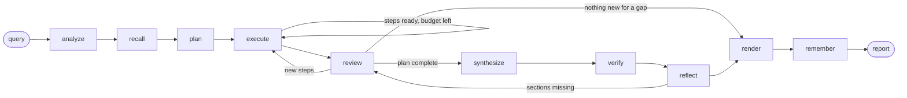

# ARA-1 — Agent Architecture Specification (Final)

**Project:** 1A — Autonomous Financial Research Agent with Multi-Source Synthesis
**Author:** Mohammad Baker Masri
**Version:** 1.0 (Day 14). Supersedes v0.1 (`architecture_specification.md`, the Day 1 draft, kept unchanged as the design record).
**Status:** Describes the system as built at the end of Day 13. Every component below was checked against the code. Where v0.1 planned something that does not exist, Section 21 says so and gives the reason.
**Related documents:** [README](../README.md) (setup and quick start), [trace_gallery.md](trace_gallery.md) (annotated reasoning traces), [evaluation_report_final.md](evaluation_report_final.md) (metric results), [optimization_log.md](optimization_log.md) (Day 13 changes), [ERROR_LOG.md](../ERROR_LOG.md).

---

## Changes since v0.1

Each row is a difference between the v0.1 design and the code. Section numbers refer to this document.

| Change | Day | Reason | File |
|---|---|---|---|
| Graph has ten nodes: `analyze`, `recall`, `plan`, `execute`, `review`, `synthesize`, `verify`, `reflect`, `render`, `remember`. `review` replaces `replan` and runs once the plan has no ready steps, not after each batch. | 4 | One review per plan completion costs fewer free-tier LLM calls than a re-plan after every batch. | `agent/core.py` |
| No LangGraph checkpointing. A run is bounded by a wall-clock limit (default 300 s) instead of being resumable. | 4 | Runs finish inside the limit; no resume case came up. | `agent/core.py` |
| Research deadline plus a writing reserve (a quarter of the time, at least 60 s, at most half). LLM waits and retries are clipped to the deadline. | 4–5 | Slow downloads and rate-limit waits used the whole run and left no time to write. | `agent/core.py`, `agent/llm.py` |
| LLM client classifies 429 as per-minute or daily quota, and sets providers aside (30 s, 1 h, 10 min local). | 4, 6 | Gemini's per-minute "exceeded your current quota" was benching it for an hour; Groq daily quotas ran out mid-run. | `agent/llm.py` |
| Per-provider output cap (`max_output_tokens = 1000` for Groq Qwen). | 4 | Groq's free tier rejects larger requests for that model. | `config/default.toml` |
| Web search tries `ddgs` back ends brave, bing, duckduckgo, then Google News RSS. | 5 | DuckDuckGo's own endpoint was unreachable from the development network. | `tools/web_search.py` |
| Shared HTTP layer: per-host token bucket, disk cache with TTL, retries honouring `Retry-After`. Rate limits are per host, not per tool. | 5 | Several tools share one host; free sources need caching. | `tools/http.py` |
| Short-term memory is the function `fit_evidence`, not a `ContextManager` class. Compression is extractive (no LLM). No trace summarisation. | 6 | The trace is not sent to the model, so there was nothing to summarise. | `memory/context_manager.py` |
| Long-term write policy stores every chunk with a tier-based confidence and a `verified` flag. There is no 0.7 threshold. Mock data is never persisted. | 6 | Flagged paragraphs are kept, marked unverified (confidence 0.4), so they stay auditable. | `memory/manager.py`, `memory/chunking.py` |
| Episodic lessons are rule-based, not written by the LLM. | 6 | Zero LLM cost. | `memory/episodic.py` |
| Fallback chains differ from v0.1: no EDGAR full-text search step, no BM25 fallback, no write-ahead log. `vector_db_search` falls back to `web_search`. | 9 | Not needed once XBRL and the submissions API worked; BM25 and the log add code with no observed use. | `agent/fallback_chains.py` |
| Error handling written in-house (error classes, per-class retry allowance, per-provider breaker, global guard `max_open_providers`). `tenacity` is not used. | 9 | Per-class allowances and an injectable clock were easier to test. | `agent/error_handler.py`, `agent/circuit_breaker.py` |
| The LLM chain uses its own cooldowns, not the breaker board. | 4, 9 | Provider cooldowns need quota-specific rules. | `agent/llm.py` |
| Synthesis is deterministic and reads structured sources only (`financial_data_api`, `peer_comparison`). News and web text are never parsed for figures. | 8 | A headline's "$3bn" must not pass as a filed figure. | `synthesis/engine.py` |
| Conflicts are rendered inside "Data Gaps and Limitations". Per-claim confidence is shown in the brief and the conflict table, not in an appendix. | 8 | Keeps the report within the template's sections. | `agent/core.py`, `synthesis/narrative.py` |
| Query analysis and disambiguation are rule-based. There is no LLM tiebreaker. Interactive mode exists in `disambiguate` but is not wired to the CLI. | 10 | Reproducible and costs no quota. | `agent/query_analyzer.py`, `agent/disambiguation.py` |
| Coverage flags (private company, recent IPO, non-US filer) and temporal-sensitivity flags are produced from tool outcomes and news and 8-K dates. | 10 | Section 15.3 edge cases. | `agent/disambiguation.py` |
| Evaluation has 22 spec metrics plus BM-1. The planned Brier-score calibration metric was not built. Judge makes one cached call per report. | 11 | Per-claim confidence is not recorded in the run bundle. Free-tier quota limits judging. | `evaluation/metrics.py`, `evaluation/judge.py` |
| Verifier flags executives named in no source. | 12 | C6 invented two bank CEOs. | `tools/fact_checker.py`, `agent/core.py` |
| `agent/references.py` resolves symbolic calculation inputs (`s2.revenue_FY2026`) without the LLM. | 12 | Repair calls cost a call each and failed in C4 and C5. | `agent/references.py` |
| A report cut off by a model's output limit is continued (up to 2 continuations). | 12 | Groq Qwen's 1,000-token cap cut reports; C8 lost 4 of 7 sections. | `agent/core.py` |
| `resilience.fail_tools` / `ARA_FAIL_TOOLS` / `--fail-tools`. | 12 | Challenge 8 names two tools; injection hit all network tools. | `config/default.toml`, `agent/__main__.py` |
| Stress tests (concurrency, maximum context, total outage) and token profile. | 12 | Spec Day 12 tasks. | `evaluation/stress.py`, `evaluation/token_profile.py` |
| Execute calls send only the planned tool's schema (T1). | 13 | Execute was 56% of tokens. | `agent/core.py`, `agent/prompts.py` |
| Synthesis prompt budget depends on the provider: gemini 24,000, groq 6,000, ollama 6,000, at 90% (T2), with a refit retry. | 13 | One 6,000-token cap starved Gemini. | `config/default.toml`, `config/settings.py`, `agent/core.py` |
| Review is skipped when nothing failed and no gap is pending (T3), and when no LLM provider is ready (T4). | 13 | The review mostly answered "done". | `agent/core.py`, `agent/llm.py` |
| Forward-view rule in the synthesis prompt (P1). | 13 | AD-4 was 0–1 sections in 7 of 8 reports. | `agent/prompts.py` |
| `enforce_tickers` for company-specific steps (P2). | 13 | C7: 11 of 25 steps skipped for lack of a ticker. | `agent/core.py` |
| Sharper descriptions for four tools. | 13 | 27 skipped steps across three tools. | `tools/schemas/*.json` |
| Section-targeted memory recall (M1). | 13 | AB-4 passed in 1 of 8 runs. | `agent/core.py` |
| Chunk size 1500 → 500 characters (M2). | 13 | hit@3 35% → 52% on a 48-probe set. | `memory/chunking.py` |
| Trace viewer CLI `python -m agent.trace_viewer`. | 14 | Replaces the planned `rich` pretty-printer. | `agent/trace_viewer.py` |

## Table of Contents

1. Purpose and Scope
2. Design Constraints
3. Requirements Traceability
4. Research Principles
5. Choice of Agent Pattern
6. System Overview
7. The Cognitive Loop
8. LLM Layer
9. Tool Registry
10. Memory Architecture
11. RAG Pipeline
12. Multi-Source Synthesis Engine
13. Verification and Hallucination Control
14. Error Handling and Graceful Degradation
15. Query Analysis and Disambiguation
16. Observability and Auditability
17. Evaluation Framework
18. Challenge Strategy
19. Configuration and Run Modes
20. Extensibility Toward Multi-Agent
21. Risks, Items Not Built, and Open Issues
22. Build Record

---

## 1. Purpose and Scope

ARA-1 is an autonomous research agent that does the work of a junior sell-side or buy-side analyst. It takes a natural-language research request and produces an investment research report in Markdown. It needs no step-by-step human guidance. Figures in the report cite retrieved evidence (`[E12]`), and the verifier checks each cited figure against that evidence.

**In scope**

- US-listed public companies. The agent works from SEC filings, market data, earnings communications, news and web search.
- Seven report templates (`tools/report_gen.py` `TEMPLATES`): company profile, earnings analysis, risk assessment, comparative analysis, investigative, thematic, full report. The eight challenges map onto them. C6 (ambiguous query) uses the company-profile template and documents its assumptions in the methodology section.
- Reproducible runs, full reasoning traces, and automatic scoring on 22 metrics plus one benchmark metric.

**Out of scope**

- Investment recommendations. The system prompt forbids them (P10).
- Real-time trading data and intraday analytics.
- A full multi-agent system (Project AAI-3B). Section 20 describes the interfaces.
- Non-US regulators. The registry could take such tools, but none are built.

## 2. Design Constraints

| Constraint | Consequence |
|---|---|
| **Zero budget**: no paid APIs, no credit card | LLM chain Gemini free tier → Groq free tier (two models) → local Ollama. Data sources are free: SEC EDGAR and XBRL, yfinance, `ddgs` web search, Google News RSS, Motley Fool transcripts. Embeddings run locally. |
| **Free-tier rate limits** | Per-host rate limiter and disk cache for HTTP, an in-process result cache per tool, provider cooldowns for the LLM, and a per-provider prompt budget. Memory is searched before any external call. |
| **Modest local hardware** (16 GB RAM, 4 GB GPU) | The local model (`qwen2.5:3b`) is the last fallback. Embeddings use Chroma's ONNX MiniLM on the CPU. |
| **At most 20 tool calls per task** | `agent.max_tool_calls = 20`, enforced by `_take_call`. The plan holds at most 16 steps; the rest is kept for repairs and follow-ups. |
| **Latency under 5 minutes** | Default `max_seconds = 300`. Independent steps run concurrently (4 workers). AB-5 passed in 8 of 8 runs on Day 11 and Day 13. |
| **Hallucination rate under 2%** | Citations by evidence id, a verifier that checks every sentence with a figure, and calculations done in code. On Day 13, FA-5 (untraceable claims) passed in 6 of 8 runs. |

## 3. Requirements Traceability

| Spec requirement | Where it is met | Module(s) |
|---|---|---|
| ReAct or Plan-and-Execute loop | Plan-and-Execute graph with a bounded ReAct executor | `agent/core.py` |
| ≥10 tools with OpenAI-style schemas | 12 tools, one JSON schema each | `tools/schemas/`, `tools/tool_registry.py` |
| Tool selection without the A2.3 anti-patterns | Memory recall before planning, one schema per execute call, call budget, planner rules | `agent/prompts.py`, `agent/core.py` |
| Three-layer memory | Short-term `fit_evidence`, Chroma long-term store, SQLite episodic store, plus a SQLite facts store | `memory/` |
| Semantic chunking per document type | Chunkers for filings, transcripts, news and report findings | `memory/chunking.py` |
| Retries with backoff and jitter | 1 s × 2ⁿ plus 0–0.5 s jitter, up to 5 retries for transient and rate-limited errors | `agent/error_handler.py` |
| Fallback chains, at least 2 per tool | `FALLBACK_CHAINS` (2–3 fallbacks for each network tool) | `agent/fallback_chains.py` |
| Circuit breaker | One breaker per data provider | `agent/circuit_breaker.py` |
| Fact verification with a 5% tolerance | Sentence-level checking in `verify` | `agent/core.py`, `tools/fact_checker.py` |
| Graceful degradation | "Data Gaps and Limitations" always rendered | `agent/core.py`, `tools/report_gen.py` |
| Source reliability hierarchy (corrected, ERROR_LOG #2) | `tier_weights` in config | `synthesis/conflict_resolver.py` |
| Conflict-resolution protocol | `resolve`, with a `ConflictRecord` per conflict | `synthesis/conflict_resolver.py` |
| Narrative threading, sentiment-fact alignment | Deterministic threads | `synthesis/narrative.py` |
| Query disambiguation | Analyser plus disambiguation module | `agent/query_analyzer.py`, `agent/disambiguation.py` |
| Dynamic tool unlocks | `UnlockRule` evaluated by the registry; off by default | `tools/tool_registry.py` |
| 20+ evaluation metrics | 22 metrics plus BM-1 | `evaluation/metrics.py` |
| Trace gallery | JSONL traces and a viewer CLI | `agent/tracing.py`, `agent/trace_viewer.py` |

## 4. Research Principles

Each principle is a rule in the system prompt (`agent/prompts.py` `SYSTEM_PROMPT`). The table says what the code enforces beyond the prompt.

| ID | Principle | Enforced by |
|---|---|---|
| P1 | No number without a source. | The prompt. `verify` marks an uncited figure `*(unverified: no source cited)*` and adds it to the data-gaps list. `report_generator` reports unknown and unused citations. |
| P2 | Numbers are computed, not generated. | The prompt and the planner rule to plan `calculation_engine` steps. `agent/references.py` fills calculation inputs from the data. The verifier does not recompute derived figures (the evaluation metrics do). |
| P3 | Check memory first. | `recall` always runs before `plan`. |
| P4 | Structured sources before web search. | Tool descriptions and the planner prompt. |
| P5 | Growth only relative to a baseline. | The prompt only. |
| P6 | Every conflict is shown. | The resolver writes a `ConflictRecord`; the report renders a conflicts table. |
| P7 | Name gaps, never fill them. | The prompt, the mandatory gaps section, and fallback disclosure. |
| P8 | Facts and inferences apart ("Analysis:"). | The prompt. The LLM judge scores flow and quality. |
| P9 | Every figure has a period. | The prompt. Claims carry a `Period` (`fiscal_year`, `fiscal_period`, `period_end`) and the brief prints it. |
| P10 | No investment recommendation. | The prompt only. There is no output filter for "buy/sell/hold". |

## 5. Choice of Agent Pattern

### 5.1 Options considered

| Pattern | Strengths | Weaknesses for this project |
|---|---|---|
| Pure ReAct | Adapts after every observation | Many tool calls; hard to stay within 20; unbounded trace |
| Pure Plan-and-Execute | Efficient and reviewable; independent steps run in parallel | Rigid when early findings change the picture |
| **Hybrid: plan, execute with a bounded ReAct, review** | Efficient and auditable; steps can adapt locally; review can add steps | More code than either pure pattern |

### 5.2 Decision

**Hybrid.** The planner makes one LLM call that returns a dependency graph of steps (`PlanStep`: `id`, `goal`, `tool`, `args`, `depends_on`, `reason`, plus run state `status`, `evidence_ids`, `summary`, `attempts`). A step with complete `args` is a direct tool call. A step with `args = null` runs as a ReAct loop of at most `max_calls_per_step = 3` attempts. After the plan has no ready steps, `review` may add steps (at most `max_replans = 3` reviews). The agent can also loop from `reflect` back to `review` when a section is missing.

### 5.3 Implementation substrate

The outer loop is a LangGraph `StateGraph` over a `TypedDict` (`ResearchState`). Each node is a method `_node_<name>` on `ResearchAgent`. The graph is compiled without a checkpointer. Model calls go through ARA-1's own `LLMClient` (Section 8), not LangChain wrappers.

## 6. System Overview

The LangGraph as built (`agent/core.py`, `_build_graph`):



The Day 1 diagram (`architecture_diagram.svg`) shows the v0.1 design and is kept as a historical record; where it differs, this document and the graph above are correct (see Section 21, "Open issues").

The system has five layers:

1. **Agent graph.** `analyze → recall → plan → execute ⇄ review → synthesize → verify → reflect → render → remember`.
2. **Tool layer.** A registry of 12 tools. Calls from plan steps go through `ResilientDispatcher` (validate → retry per error class → circuit breaker → fallback chain), which calls `ToolRegistry.dispatch` (cache → handler → output check).
3. **Memory layer.** `fit_evidence` (short-term), Chroma (long-term), SQLite facts, SQLite episodes, managed by `MemoryManager`.
4. **Synthesis and verification.** Claim ledger, conflict resolution, narrative threads, sentence-level fact checking.
5. **Cross-cutting.** `LLMClient` with provider fallback, `TraceLogger`, the evaluation harness, and configuration.

## 7. The Cognitive Loop

### 7.1 Graph

```
analyze → recall → plan → execute ─┬─(ready steps, budget and time left)──→ execute
                                   └─(otherwise)──→ review ─┬─(new ready steps)──→ execute
                                                            ├─(no new steps)──→ synthesize → verify → reflect
                                                            └─(skip_resynthesis)──→ render
reflect ─┬─(sections missing, caps not reached)──→ review
         └─(otherwise)──→ render → remember → END
```

**Nodes** (`agent/core.py`)

| Node | What it does | State it writes |
|---|---|---|
| `analyze` | `analyze_query` (rules) then `disambiguate`. Fills `profile.tickers` from sector defaults when the query names no company (not for cross-memory queries). Traces the assumptions. | `profile` |
| `recall` | Memory first. For each ticker, one query-wide `vector_db_search`, then up to two section-targeted searches (Section 10.5). For a cross-memory query with no company, targets are `memory.known_companies()`. Adds planner hints from episodic memory and a facts summary. | `memory_notes`, `memory_tickers` |
| `plan` | One LLM call (`json_mode`, `reasoning_effort="low"`, `max_tokens=2048`), retried once with the parse error appended. `parse_plan` validates tools, arguments, dependencies and cycles. `enforce_tickers` fixes or drops company-specific steps with no ticker. If no plan is usable, `default_plan` (profile, income statement, key ratios, latest 10-K and news per ticker). | `plan` |
| `execute` | Runs the plan's ready steps, concurrently with up to `max_workers = 4`. See 7.3. | `plan` |
| `review` | Adds steps for real gaps (Section 7.4). | `plan`, `replans`, `pending_gaps`, `skip_resynthesis` |
| `synthesize` | Builds the ledger, threads and brief, fits the evidence to the provider's budget, and writes all sections in one LLM call with continuation on cut-off. | `sections` |
| `verify` | Sentence-level fact checking (Section 13). | `sections`, `verification` |
| `reflect` | Lists template sections that are missing. If any are, caps allow, and budget and time remain, writes `pending_gaps` and increments `reflections`. | `pending_gaps`, `reflections` |
| `render` | Adds the data-gaps section (coverage flags, gaps, unverified claims, temporal flags, conflicts table) and the methodology section, then calls `report_generator`. | `report` |
| `remember` | Ingests source material, statements and the report's findings into memory. Errors never fail the run. | none |

After the graph ends, `run()` records the episode through `MemoryManager.record_episode`.

### 7.2 State

```python
class ResearchState(TypedDict, total=False):
    query: str
    profile: QueryProfile        # template, tickers, names, query_type, complexity, periods, ambiguity, signals, sector
    memory_notes: str
    memory_tickers: list[str]
    plan: Plan                   # steps, rationale, rejected
    replans: int
    reflections: int
    pending_gaps: list[str]
    skip_resynthesis: bool
    sections: dict[str, str]
    verification: dict[str, Any]
    report: dict[str, Any]
```

Run-wide data lives on the agent instance, not in the graph state: `evidence: dict[str, ToolResult]` (evidence id → result), `gaps: list[str]`, `ledger`, `failures`, `budget_used`, `breakers`, `resilience_events`. One `ResearchAgent` instance must not be shared between threads (stress test finding); one agent per task is safe.

A `ToolResult` is the evidence record: `evidence_id`, `tool`, `args`, `data`, `source_tier`, `retrieved_at`, `latency_ms`, `cache_hit`, `is_mock`, `is_fallback`.

### 7.3 Execution and safety limits

- **Direct and ReAct steps.** `_run_step` calls the tool directly when `args` is known. On a validation error, or when `args` is null, it asks the LLM for a tool call (`tool_choice="auto"`, `max_tokens=1024`) and sends only the planned tool's schema (T1). A reply with no tool call ends the step as "not needed". The system tools (`report_generator`, `fact_checker`, `vector_db_search`, `vector_db_store`) cannot be called in a step.
- **Tool budget.** 20 logical calls (`_take_call`). Retries and fallbacks inside `ResilientDispatcher` do not count. Exhaustion is recorded as the stop reason.
- **Iteration caps.** `max_replans = 3`, `max_reflections = 2`.
- **Wall-clock.** `max_seconds` (CLI `--max-seconds`, default 300). Research stops at `deadline − reserve`, where the reserve is `min(max_seconds / 2, max(60, max_seconds / 4))`. Each tool call runs in a thread pool and is abandoned when the research deadline passes (the download continues and is cached). LLM calls for research use the research deadline; the writing calls use the final deadline.
- **Provider guard.** When `max_open_providers = 3` data providers are open at once, research stops and the report is written from what exists (`_providers_down`).
- **Repeated calls.** There is no argument-hash guard. Repeats are limited by the planner prompt ("never plan the same tool with the same arguments twice"), the registry's result cache, and the 3-attempt cap per step.
- **Missing sections.** `reflect` triggers another review only for missing template sections. The report renders an unfinished section as "could not be completed" and lists it in the gaps section. A source-diversity check (CO-2) exists only in the evaluation.

### 7.4 Review

`_node_review` runs when the plan has no ready steps. In order:

1. If `max_replans` is reached, or budget or time is gone: no new steps; `skip_resynthesis` is set when the review was gap-driven.
2. If `LLMClient.any_provider_ready()` is false: no LLM call; the decision is traced (T4).
3. If there is no pending gap and no failed or skipped step: a deterministic "research complete" decision, no LLM call (T3).
4. Otherwise one LLM call (`purpose="review"`). `parse_replan` accepts `{"action": "done"}` or new steps. New steps pass `enforce_tickers`.

Routing after review: new ready steps → `execute`; none → `synthesize`, or `render` when `skip_resynthesis` is set.

## 8. LLM Layer

### 8.1 Client and adapters

`LLMClient.complete(messages, *, tools, tool_choice, json_mode, temperature, max_tokens, reasoning_effort, purpose, deadline)` returns an `LLMResponse` (`content`, `tool_calls`, `usage`, `provider`, `model`, `latency_ms`, `finish_reason`, `fallback_depth`, `errors`). Tool schemas are written once in OpenAI function-calling format.

Gemini, Groq and Ollama expose OpenAI-compatible endpoints, so `OpenAICompatibleProvider` (the official `openai` SDK, `max_retries=0`) serves all of them by changing `base_url`, key and model. `AnthropicProvider` is a second adapter for a reviewer with a key. `MockProvider` gives scripted replies for tests.

Provider quirks handled through configuration:

- **`schema_dialect`**: the `gemini` dialect removes `additionalProperties`, `uniqueItems`, `$schema`, `$id`, `examples` and `const`, and sends free-form object parameters as JSON strings. The registry decodes them before validation.
- **Parameter name**: `max_completion_tokens` for `api.openai.com`, `max_tokens` elsewhere.
- **Thought signatures (Gemini 3)**: `ToolCall.extra` keeps each signature and `assistant_message()` re-attaches it. Without it, the next turn gets HTTP 400 (verified live).
- **Reasoning effort**: per-provider default (`minimal` for Gemini, `low` for `gpt-oss`), overridable per call. Planning, review-free synthesis and continuation ask for `low`. Hidden reasoning tokens are counted in `TokenUsage.reasoning_tokens`.
- **Verified failover (live)**: with Gemini deliberately broken, the chain answered from Groq after one non-retried attempt. A conversation begun on Gemini, with its signatures, continued on both Groq models.
- **Model retirement**: `gemini-2.5-flash` was withdrawn for new keys. The default is the pinned `gemini-3.6-flash`. `python -m config.doctor` detects a retired model.

### 8.2 Provider chain

Configured in `config/default.toml` (`llm.provider_order`). A provider whose API key is missing is skipped.

| Order | Provider key | Model | Notes |
|---|---|---|---|
| 1 | `gemini` | `gemini-3.6-flash` | Free tier. Large context. |
| 2 | `groq` | `openai/gpt-oss-120b` | `reasoning_effort = "low"`. |
| 3 | `groq_qwen` | `qwen/qwen3.8-27b` | Same key, separate rate limit. `max_output_tokens = 1000`. |
| 4 | `ollama` | `qwen2.5:3b` | Local, no key. |
| — | `openai`, `anthropic` | `gpt-4o-mini`, `claude-sonnet-5` | Optional and paid; not in `provider_order`. |
| — | `mock` | scripted | Used when `mode = "mock"`. |

Retry and cooldown rules (`LLMClient.complete`):

- Up to `max_retries = 2` retries per provider for retryable errors (`rate_limit`, `timeout`, `connection`, `server`, `bad_response`), with backoff 1 s × 2ⁿ plus jitter, capped at 60 s, honouring `Retry-After`.
- A `rate_limit` or `connection` error with another provider still to try puts the provider in cooldown for `max(Retry-After, 30 s)` (`cooldown_s`) and moves on. The provider is queued once more at the end for a final try.
- `quota_exhausted` (a daily quota) sets the provider aside for 3,600 s with no retry. It is skipped until the cooldown ends.
- A local server that refuses connections is set aside for 600 s.
- `request_too_large` is never retried. A 429 is classed as a daily quota only when its text names a daily marker and no per-minute marker.
- The `deadline` argument stops any attempt or wait that would start after the deadline.
- `next_provider_name()` and `any_provider_ready()` expose the cooldown state to the agent.

The LLM chain does not use the circuit breakers of Section 14. Its cooldowns above play that role.

### 8.3 Prompt budget and routing

`purpose` labels each call: `plan`, `execute:<step>`, `review`, `synthesize`, `synthesize:refit`, `synthesize:continue`. Writing calls use a system prompt without the tool list (about 1,000 tokens saved).

The synthesis prompt budget is `agent.prompt_tokens_by_provider[provider] × prompt_budget_share (0.9)` for the provider `next_provider_name()` returns: gemini 21,600, groq 5,400, ollama 5,400, other providers `max_prompt_tokens` (6,000) × 0.9. If synthesis fails with a budget above the default, it is retried once with the default budget.

There is no separate small-model tier for sub-tasks. Arithmetic is never sent to the LLM (P2).

Every call is traced as `llm_call` with provider, model, token counts, latency, `fallback_depth`, `attempt` and `finish_reason`. `UsageTracker` totals feed `results/token_usage_analysis.md`.

## 9. Tool Registry

### 9.1 ToolSpec and dispatch

Each tool is one JSON file in `tools/schemas/`: the OpenAI function definition plus an `x-ara` block (`handlers`, `source_tier`, `cache_ttl_s`, `fallbacks`, `domains`, `unlock`, `output_schema`). `ToolSpec` (`tools/base.py`) holds `name`, `description`, `parameters`, `handler`, `handler_mode`, `output_schema`, `source_tier`, `cache_ttl_s`, `fallbacks`, `domains`, `unlock`. Handlers are chosen by data mode (`mock`, `live` or `any`).

`ToolRegistry.validate_args` repairs harmless model mistakes (null optionals, numbers and booleans sent as strings, stringified JSON) and upper-cases tickers so cache entries are shared. `ToolRegistry.dispatch` does: unlock check → validate → cache lookup → optional `failure_injector` → handler → output-schema check (`ToolOutputError` for a malformed response) → evidence id → cache store → listener callbacks.

The agent calls tools through `ResilientDispatcher.call`, which adds retries, the circuit breaker and the fallback chain around `dispatch` (Section 14). `recall` calls `dispatch` directly, without them.

Rate limiting is per host in `tools/http.py` (`RateLimiter`, token bucket): `sec.gov` at `sec.max_requests_per_second = 8`, `news.google.com` at 2 per second. The disk cache is under `data/cache/http`. The SEC contact email goes in the User-Agent for `sec.gov` only.

**Result cache TTL** (`cache_ttl_s`): `company_profile`, `financial_data_api`, `sec_filing_search`, `peer_comparison` 86,400 s; `earnings_transcript` 604,800 s; `web_search` 3,600 s; `news_sentiment` 1,800 s; local and memory tools 0.

**Unlocks.** `UnlockRule(after_challenge)` is set on `earnings_transcript` (2), `peer_comparison` (4) and `calculation_engine` (6). `ToolRegistry(enforce_unlocks=False)` is the default, so every tool is available in every challenge (ERROR_LOG #7). `set_progress()` returns the tools that just unlocked. The mechanism works; no run enables it.

### 9.2 The 12 tools

| # | Tool | Live backend | Runtime fallbacks (`agent/fallback_chains.py`) | Tier |
|---|---|---|---|---|
| 1 | `sec_filing_search` | EDGAR ticker map, submissions API and archive documents. Filings: 10-K, 10-Q, 8-K (Exhibit 99.1 press release), DEF 14A. Parsed into items and individual risk-factor headings. | `web_search` → `vector_db_search` | 1 |
| 2 | `financial_data_api` | SEC XBRL per-concept API, then company-facts API; yfinance if there is no SEC data. Latest filing wins; restatements are reported. | `sec_filing_search` (latest 10-K) → `web_search` → `vector_db_search` | 1 (yfinance 2) |
| 3 | `company_profile` | EDGAR submissions merged with yfinance `info` | `sec_filing_search` → `web_search` → `vector_db_search` | 2 |
| 4 | `earnings_transcript` | Motley Fool call transcripts (speaker turns, prepared remarks, Q&A); if unavailable, the 8-K Item 2.02 press release | `sec_filing_search` → `news_sentiment` → `vector_db_search` | 3 |
| 5 | `web_search` | `ddgs` back ends brave, bing, duckduckgo; then Google News RSS headlines | `news_sentiment` → `vector_db_search` | 4–5 by publisher |
| 6 | `news_sentiment` | Google News RSS scored with VADER and a finance lexicon | `web_search` → `vector_db_search` | 4 |
| 7 | `peer_comparison` | Largest companies in the yfinance industry, or the `peers` argument. Metrics from SEC XBRL, market cap from yfinance. | `financial_data_api` → `company_profile` → `vector_db_search` | 2 |
| 8 | `calculation_engine` | Local Python: growth, CAGR, ratio, margin, DCF, statistics | none | derived |
| 9 | `fact_checker` | Local: compares a claim's quantities with source texts | none | derived |
| 10 | `report_generator` | Local Python rendering of the templates | none | none |
| 11 | `vector_db_search` | Chroma | `web_search` | memory |
| 12 | `vector_db_store` | Chroma | none | memory |

The `fallbacks` lists inside the schema files are metadata; the chains in `agent/fallback_chains.py` are what runs. Chain steps carry a function that maps the original arguments to the fallback's arguments; a step whose arguments cannot be mapped is skipped.

The four system tools (`SYSTEM_TOOLS` in `agent/parser.py`) are run by the agent, not planned: the verifier calls `fact_checker` as a function, `render` dispatches `report_generator`, `recall` dispatches `vector_db_search`, and memory writes go through `MemoryManager` rather than `vector_db_store`.

**The transcript gap.** When the 8-K press release replaces a call transcript, the result says so and the writer is told to state it.

**EDGAR etiquette.** A User-Agent naming the application and a contact email (`SEC_CONTACT_EMAIL`), and at most 8 requests per second.

### 9.3 Tool-selection policy

Enforced by the prompts and the executor:

1. Memory is searched before planning (`recall`).
2. The planner is told to prefer one call that returns a whole statement over several single-figure calls.
3. Structured tools come before `web_search` for figures.
4. Company-specific tools need a ticker (`enforce_tickers`); `earnings_transcript` once per company and quarter.
5. `calculation_engine` is called only when the numbers are in the evidence.

## 10. Memory Architecture

### 10.1 Layers

| Layer | Store | Lifetime | Contents | Access |
|---|---|---|---|---|
| Short-term | `fit_evidence` (`memory/context_manager.py`) | One prompt | Evidence digests fitted to a token budget | Every synthesis prompt |
| Long-term (semantic) | Chroma, persistent, collection `ara_findings__<embedding model>` | Across sessions | Chunks of filings, transcripts, news, and the report's own findings | `vector_db_search` |
| Structured facts | SQLite `facts` table (`data/facts.sqlite`) | Across sessions | Financial statement line items by ticker, period, item, with provider and evidence id | Exact lookup by ticker and period (`FactsStore`) |
| Episodic | SQLite `episodes` table (`data/episodic.sqlite`) | Across sessions | Per run: query, template, tickers, plan, tool stats, errors, metrics, lessons, score | `EpisodicMemory.hints` for the planner |

In mock mode every store is in memory and nothing is persisted. The mock vector store (`DEFAULT_STORE`) is module-level shared state.

### 10.2 Short-term context

`fit_evidence(evidence, budget_tokens, digest)`:

1. Splits evidence into primary (financial data, calculations, filings, profiles, peers) and supporting (transcripts, news, web, memory) groups at 40:30. A group that needs less passes its spare budget to the other.
2. Shrinks each item's digest evenly, from 2,500 characters down to 350.
3. If it still does not fit, drops the lowest-priority items (priority order: `financial_data_api`, `calculation_engine`, `company_profile`, `sec_filing_search`, `peer_comparison`, `earnings_transcript`, `news_sentiment`, `web_search`, `vector_db_search`). Dropped ids are listed in the prompt as not citable.

Compression is extractive (digests put the key content first), so it costs no LLM calls. The 20% system and 10% output shares of v0.1 are not modelled separately: `synthesize` subtracts the measured size of the system prompt and instructions from the budget. Token counts use tiktoken `cl100k_base`, which runs about 14% below Groq's own count on the largest prompt.

The planner and executor prompts hold digests of dependency evidence (up to 1,800 characters each), not the whole trace. Synthesis writes all sections in one call, with continuation (Section 7.1), not one call per section.

### 10.3 Long-term store

Record metadata (`_normalize_meta`): `ticker`, `source_type`, `date`, `date_ord` (integer ordinal, for range filters), `confidence`, `verified`, `researcher_session`, `stored_at`, and optional `source_url`, `evidence_id`, `section`, `kind`. Ids are a readable prefix plus a content hash, so storing the same chunk again updates it.

| Source | Chunking rule (`memory/chunking.py`, `MAX_CHARS = 500`) |
|---|---|
| 10-K / 10-Q | One chunk set per Item, split at paragraph boundaries. In Item 1A, one chunk per risk factor (`kind = "risk_factor"`), the heading repeated on long risks. |
| Earnings call | Prepared remarks per turn (`kind = "prepared"`); each analyst question with all management answers (`kind = "qa"`), long exchanges split with the question repeated. |
| News | One chunk per article: headline, source, date, sentiment. |
| Report findings | One chunk per paragraph; paragraphs carrying `*(unverified` get `verified = false` and confidence 0.4. |
| Financial statements | Not embedded. Stored in the facts table. |

**Embeddings.** The default is Chroma's ONNX `all-MiniLM-L6-v2` (384 dimensions, CPU, downloaded once). `embedding_model = "hashing"` is an offline lexical embedding for tests. The collection name includes the model id.

**Write policy** (`MemoryManager`):

- Source material is stored with confidence by tier (`TIER_CONFIDENCE`: 0.95, 0.85, 0.70, 0.60, 0.30) and `verified = false`.
- Report findings are stored with confidence 0.6 and `verified = true` when the verifier found no unsupported figure and at least one supported one; otherwise 0.5 and unverified. Flagged paragraphs are 0.4.
- News searched by name is stored only when the run names exactly one company, to avoid cross-company contamination.
- Retrieval is cosine similarity with metadata filters. It does not rank unverified chunks lower.

**Staleness.** Not built. `Claim.stale` and the 0.80 stale penalty exist in the resolver, but nothing sets the flag (Section 21).

### 10.4 Episodic memory

```sql
episodes(session_id PRIMARY KEY, created_at, query, template, tickers, plan_json,
         tool_stats_json, errors_json, metrics_json, lessons_json, score)
```

After each run, `episode_from_result` computes per-tool stats (steps, done, failed, cited) and a score `0.6 × supported share + 0.3 × done share + 0.1 × (stop reason is "completed")`. `derive_lessons` writes rule-based lessons (a tool whose data was never cited, a tool too slow, no data for a company, an early stop, uncited figures). `recall` passes the best-scoring episodes of the same template (up to 2) to the planner as hints.

### 10.5 Recall

`recall` (Section 7.1) uses the query-wide search with no relevance floor (cosine scores can be negative), then up to two searches built from the template's first two content sections ("MSFT Business Overview"), kept only above `RECALL_MIN_SCORE = 0.30`. Hits are de-duplicated by record id. Only searches with hits are stored as evidence. All are local and use no API budget.

## 11. RAG Pipeline

| Stage | As built |
|---|---|
| 1. Query transformation | `analyze_query` extracts tickers, sector, periods and query type. There is no sub-query generation and no HyDE. `recall_topics` adds two section-targeted memory queries. |
| 2. Multi-source retrieval | The plan's steps dispatch to EDGAR, XBRL, yfinance, news, transcripts and web search, concurrently where independent. Results become `ToolResult` evidence. |
| 3. Relevance filtering | Memory: Chroma cosine similarity, a 0.30 floor on targeted searches, de-duplication. There is no hybrid score, BM25 or cross-encoder (`rank-bm25` is listed in `requirements.txt` and not used by any module). |
| 4. Context assembly | `fit_evidence` orders by group and tool priority and fits the budget. Each item is rendered with its evidence id (`evidence_digest`). |
| 5. Grounded generation | One synthesis call. The prompt requires evidence ids on every figure, a period on every figure, "Analysis:" on inferences, and the synthesis brief's resolved values. |
| 6. Post-generation verification | `verify` (Section 13). |

**Iterative retrieval.** `reflect → review → execute` turns a missing section into new steps. In the live runs the review LLM was skipped in 6 of 8 runs on Day 13 (T3), so this loop is used rarely.

## 12. Multi-Source Synthesis Engine

### 12.1 Claim ledger

`extract_claims` (`synthesis/engine.py`) builds claims only from structured tool results: `financial_data_api` rows and `peer_comparison` rows, plus margins derived from cited statement rows. Money is stored in USD, ratios as fractions. Claim ids are `C1..Cn` in evidence order.

```python
@dataclass
class Claim:
    claim_id: str
    entity: str                  # ticker
    metric: str                  # "revenue", "operating_margin", ...
    period: Period               # fiscal_year, fiscal_period ("FY", "Q1".."Q4"), period_end
    value: float | str
    unit: str                    # "USD", "ratio", "USD/share", "count"
    evidence_ids: list[str]
    source_tiers: list[int]
    provider: str                # "sec_xbrl", "yfinance", "peer_comparison:sec_xbrl", ...
    filed: str | None
    is_fallback: bool
    stale: bool
    confidence: float
    status: Literal["verified", "single_source", "conflicted", "unverified"]
```

### 12.2 Normalisation

- **Units.** USD base units; ratios as fractions; peer revenue (reported in millions) is converted.
- **Periods.** Claims group by `(entity, metric, fiscal_year, fiscal_period)`. Different periods never conflict. Fiscal years follow the filing's own fiscal-year labels (NVIDIA FY2026 ended January 2026).
- **Entities.** One ticker per claim; tickers resolve through the SEC ticker map.

### 12.3 Conflict resolution

Tier weights (`synthesis.tier_weights`, corrected order from ERROR_LOG #2):

| Tier | Source | Weight |
|---|---|---|
| 1 | SEC filings and XBRL | 0.95 |
| 2 | Curated financial data (yfinance) | 0.85 |
| 3 | Company communications (calls, press releases) | 0.70 |
| 4 | Major news outlets (allow-list `MAJOR_NEWS_DOMAINS` in `conflict_resolver.py`) | 0.60 |
| 5 | Other web | 0.30 |

For each group with more than one value, `resolve` treats values as the same fact when they agree within 5% of the larger (`TOLERANCE`), or within 0.005 for ratios. Otherwise `_resolve_conflict` applies, in order:

1. **Restatement** (`restatement_latest_filing`): one provider, several filing dates, different values. The latest filing wins.
2. **Triangulated majority** (`triangulated_majority`): three or more values and one cluster has the most members.
3. **Highest tier** (`highest_tier`): values differ across tiers and the best tier agrees with itself.
4. **Unresolved range** (`unresolved_range`): sources of equal reliability disagree. The range is reported and confidence is capped at 0.50.

Every conflict gets a `ConflictRecord` (values, chosen value, method, rationale, confidence), traced as a `decision` event named `conflict:<method>` and rendered in the report as a table. There are no separate "check timing" and "check definitions" steps: timing differences are handled by grouping on period, and definitions are not compared (Section 21).

### 12.4 Confidence

```
conf = tier_weight(best tier)
     + 0.05 × (independent agreeing providers − 1)      [capped at 0.99]
     × 0.90 if every supporting claim came via a fallback
     × 0.80 if stale          (flag is never set today)
     → min(conf, 0.50) if the conflict is unresolved
```

"Independent" means a different base provider. `peer_comparison:sec_xbrl` and `sec_xbrl` count as one, because peer figures are rebuilt from XBRL.

### 12.5 Narrative threads

`build_threads` (`synthesis/narrative.py`) is deterministic and uses no LLM:

- `sentiment_vs_fundamentals`: news sentiment (VADER) against the direction of growth and net income. A divergence becomes a thread. This is the mechanism for Challenge 5.
- `growth`, `profitability`, `competition`, `capital_allocation` per company.

Each thread has a thesis, supporting and contradicting evidence ids, a "so what", and the tools it drew on. `render_brief` packs resolved figures, conflicts and threads into a brief of at most `synthesis.brief_tokens = 900` tokens for the writer.

Forward-looking content comes from the synthesis prompt's forward-view rule (P1, Day 13), grounded in cited guidance. There is no code for scenario analysis. `valuation_scenarios` is a section of the `full_report` template, written by the LLM.

## 13. Verification and Hallucination Control

`_node_verify` checks every sentence, table row and list item that contains a figure (`_claims` splits the section text; list items and table captions inherit citations). For each claim, in order:

1. **Names.** `unsupported_names` flags an executive named next to a title who appears in no source. The claim is marked `*(unverified: ... not found in sources)*`.
2. **Quantities.** `extract_quantities` parses numbers, scales (thousand to trillion), percentages, basis points, ranges and dollar amounts, and ignores form names, period labels and hyphenated labels.
3. **Citations.** The claim's own `[E#]` ids, or inherited ones. With none, `_find_single_source` looks for exactly one evidence item that matches every figure; if found, the citation is added (counted as `auto_cited`). Otherwise the claim is marked `*(unverified: no source cited)*` and counted as `uncited`.
4. **Check.** `fact_checker` compares each quantity with the cited evidence text within 5%, accepting scale variants. Results: `supported`, `partially_supported`, `unsupported`, `unverifiable`. Partial and unsupported claims are marked `*(unverified)*`.
5. **Report.** The tally (`checked`, `supported`, `unsupported`, `uncited`, `auto_cited`, `unsupported_names`) goes to the trace, the methodology section, the episode record, and the memory write policy. Flagged claims are listed in "Data Gaps and Limitations".

Verification text for large documents is cut at 400,000 characters (filings) and 250,000 (transcripts).

**Not in the verifier** (v0.1 planned them): recomputing derived figures, cross-referencing an independent source, principle rules P5 and P10, a CS-2 consistency check, deleting a claim that cannot be fixed, and a per-claim confidence appendix. The evaluation computes derivability (FA-1), contradictions (CS-2) and so on after the run. A flagged claim is marked and disclosed, not removed.

**Citation integrity (FA-2).** The Sources section is rendered from the evidence list by `report_generator`. `report_checks` carries `missing_sections`, `unknown_citations` and `uncited_sources` for each run. A model can still write a wrong id; FA-2 measures that.

## 14. Error Handling and Graceful Degradation

### 14.1 Error classes

`classify` (`agent/error_handler.py`) maps an exception to a class. Exception type wins over message text.

| Class | Detection | Retries | Counts toward breaker |
|---|---|---|---|
| `transient` | HTTP 5xx, connection errors, `retryable` handler errors | up to `retry.max_retries = 5` | yes |
| `rate_limited` | HTTP 429, "rate limit" | up to 5; wait is at least `Retry-After` | yes |
| `timeout` | "timed out" | 1 | yes |
| `malformed` | `ToolOutputError` (output-schema check) | 1 | yes |
| `auth` | HTTP 401/403 | 0 | yes |
| `invalid_args` | `ToolValidationError` | 0; the executor asks the LLM to repair the arguments | no |
| `not_found` | HTTP 404, "no EDGAR filer", "no data" | 0 | no |
| `unavailable` | no handler, locked, circuit open | 0 | no |
| `permanent` | anything else | 0 | no |

| Failure type | Handling |
|---|---|
| Hallucination | Section 13: mark and disclose |
| Premature conclusion | `reflect` re-opens review for missing sections |
| Circular reasoning | Prompt rule, result cache, 3-attempt cap (no hashing) |
| Conflicting sources | Section 12.3 |
| Unit confusion | Section 12.2 |
| Misattribution | One ticker per claim; news stored only when the company is unambiguous |
| Stale data | Not handled in code (Section 21) |

### 14.2 Retry policy

`RetryPolicy`: delay = `1 s × 2^attempt + U(0, 0.5 s)`, clamped to 60 s; for rate limits the larger of that and `Retry-After`. No retry starts after the research deadline or while the breaker is open. Retries count against wall-clock time, not the tool budget. `[retry]` in `config/default.toml` sets `base_delay_s`, `max_retries`, `max_jitter_s`.

### 14.3 Circuit breaker

One `CircuitBreaker` per provider (`TOOL_PROVIDERS`: `sec_edgar` for `sec_filing_search`, `financial_data_api` and `company_profile`; `transcripts`; `yfinance` for `peer_comparison`; `web_search`; `google_news`). Local tools have none.

- **Closed → open:** `consecutive_failures = 3`, or at least `window_failure_ratio = 0.5` failures in the last `window = 6` calls.
- **Open:** calls fail at once (`unavailable`) and go to the fallback chain. `cooldown_s = 30`.
- **Half-open:** one trial call at a time. Success closes; failure reopens. A trial that ends without evidence (bad arguments, "no data") releases its slot.
- **Global guard:** `max_open_providers = 3` open at once stops research and the agent writes the report from existing evidence.

### 14.4 Fallback chains and gaps

`ResilientDispatcher.call` tries the primary tool, then each `Fallback` in `FALLBACK_CHAINS`. A fallback result is marked `is_fallback`, gets notes ("Fallback: X failed (...); data from Y"), emits `fallback_used`, and adds a gap line to the report. If every step fails, an `AllFallbacksFailed` carries a `Gap` (missing information, cause, tools attempted, suggested manual source).

### 14.5 Graceful degradation

`render` always writes "Data Gaps and Limitations": coverage flags, step failures and fallbacks, unverified claims, temporal flags, and the conflicts table. The methodology section lists tools used, models used, verification counts, the stop reason, fallback data, retries, open breakers, and any injected failures. A template section with no text is rendered as "This section could not be completed."

### 14.6 Failure injection (Challenge 8)

`FailureInjector` (rate, per-tool rates, kinds `timeout`, `http_503`, `malformed`, seed) is installed on the registry, so it sits below retries and breakers and exercises the real recovery path. Local tools are never injected. Settings: `resilience.fail_rate`, `resilience.fail_tools`, `fail_seed`; environment `ARA_FAIL_RATE`, `ARA_FAIL_TOOLS`, `ARA_FAIL_SEED`; CLI `--fail-rate`, `--fail-tools`, `--fail-seed`.

**Measured.** Challenge 8 (50% on `financial_data_api` and `sec_filing_search`): 4 failures injected, 4 recovered, 4 disclosed, all 7 sections present, 54 s. Stress test with every network tool failing (rate 1.0), mock mode: no exception, 5 tool calls, stop reason "several data providers are down (google_news, sec_edgar, web_search)", gaps reported (`results/stress_test_report.md`).

## 15. Query Analysis and Disambiguation

### 15.1 Query profile

`analyze_query` (`agent/query_analyzer.py`) is rule-based, with no LLM and no network. It returns a `QueryProfile`:

- **template**: first match in `TEMPLATE_RULES` (full report, investigative, earnings, comparative, thematic, risk), default `company_profile`.
- **query_type**: `profile`, `earnings`, `risk`, `comparison`, `investigative`, `thematic`, `full_report`, `factual` or `ambiguous`.
- **tickers, names**: from the `KNOWN_COMPANIES` map, bare known tickers and `(NASDAQ: X)` hints.
- **periods**: explicit (`FY2025`, `Q3 2026`) or relative.
- **complexity**: `single_company`, `multi_company`, `sector` or `cross_memory`.
- **ambiguity** (0–1) with its signals: +0.45 no company, +0.2 a group but no companies, +0.15 no aspect, +0.1 no timeframe, +0.1 very short, −0.2 refers to earlier research. Low < 0.3, high > 0.7.

### 15.2 Disambiguation policy

`disambiguate` (`agent/disambiguation.py`):

| Ambiguity | Behaviour |
|---|---|
| Low | Proceed. Note an assumed timeframe if none was given. |
| Medium or high, autonomous mode (the only mode the agent uses) | Proceed on the most likely reading. For a sector with no company, use `SECTOR_DEFAULTS` (tickers, scope, exclusions, themes). Record the assumptions and the clarifying questions it would have asked (at most 3). With no company and no known sector, research stops with a gap and the questions. |
| High, interactive mode | `disambiguate(..., mode="interactive")` returns the questions and no tickers. The CLI and agent do not use this mode. |

`render_assumptions` writes the "Scope and assumptions" block into the methodology section. Worked example (C6, "the banks"): scope US large-cap banks (JPM, BAC, C, WFC, GS, MS), latest reported period, themes earnings and net interest margin, credit quality, capital and stress tests, regulation; non-US and regional banks excluded, with the reason.

Sector defaults exist for banks, technology, semiconductors, automotive, cloud computing and energy.

### 15.3 Edge cases

Produced after research by `coverage_flags` and `rate_of_change_flags` (`agent/disambiguation.py`):

- **Private company or no EDGAR filer**: flagged from "no EDGAR/SEC filer" failures; Tier 1 sections are reported as unavailable.
- **Recent IPO**: flagged from "Only N annual periods available".
- **Non-US filer**: flagged from 20-F evidence or errors. `sec_filing_search` does not map 20-F or 6-K filings; the flag says coverage is limited.
- **Rapidly changing situation**: event rules over news headlines and recent 8-K items in the last 60 days produce a temporal-sensitivity flag, shown at the top of the executive summary.

## 16. Observability and Auditability

`TraceLogger` writes `traces/{session_id}.jsonl` (one JSON object per line, thread-safe, flushed per event). Each event has `seq`, `ts`, `session_id` and `type`. Fields under credential-like keys (`api_key`, `authorization`, `password`, `secret`, `token_value`, hyphens treated as underscores) are replaced with `[REDACTED]`.

| Event | Source | Main fields |
|---|---|---|
| `session_start`, `session_end` | `run()` | query, limits; stop reason, tool calls, evidence count |
| `thought` | nodes | text, node, step id |
| `decision` | `plan`, `review`, `analyze`, `synthesize` | chosen, rationale, step id, args, `depends_on`; `conflict:<method>` decisions |
| `action` | registry listener | tool, args |
| `observation` | registry listener | tool, evidence id, cache hit, latency |
| `error` | registry listener, parser, LLM client | source, tool or provider, error kind, message, attempt, cooling down |
| `llm_call` | `LLMClient` | provider, model, purpose, tokens, reasoning tokens, latency, fallback depth, attempt, finish reason |
| `metric` | `synthesize`, `verify` | `synthesis_ledger`, `synthesis_prompt_budget`, `verification` |
| `note` | all | free text, including `resilience <kind>` events (retry, breaker_open, fallback_used, fallback_failed, gap) |

The `conflict` type is allowed but not emitted; conflicts are logged as `decision` events. The `action` event does not carry provider, attempt or fallback flag; retries and fallbacks appear as `note` events. Metrics scored by the evaluation harness are not written back to the trace.

**Trace viewer.** `python -m agent.trace_viewer <trace.jsonl | run-bundle.json> [--types a,b] [--step s3] [--limit N]` prints events through `format_event`, coloured with `rich`. A run bundle (`results/runs/C*.json`) is read through its `trace_events` list. Tests are in `tests/test_trace_viewer.py`.

## 17. Evaluation Framework

`evaluation/metrics.py` scores a run bundle only, so metrics can be recomputed without a new research run. `REGISTRY` holds the 22 spec metrics; `evaluation/benchmark.py` adds BM-1. The planned Brier-score calibration metric was not built.

| ID | Metric | Method | Target |
|---|---|---|---|
| FA-1 | Numerical accuracy | Automated: report figures against evidence, derived figures accepted when derivable from the claim's paragraph | ≥ 98% |
| FA-2 | Citation accuracy | Automated: cited evidence exists and supports the sentence | 100% |
| FA-3 | Temporal accuracy | Automated: periods named in a claim against the cited evidence | 100% |
| FA-4 | Entity accuracy | Automated: tickers and names against evidence | 100% |
| FA-5 | Hallucination rate | Automated: untraceable claims | 0 |
| CO-1 | Section coverage | Automated | 100% |
| CO-2 | Source diversity | Automated: distinct source types cited | ≥ 4 |
| CO-3 | Temporal coverage | Automated: fiscal years within 5 years of the latest | ≥ 3 |
| CO-4 | Risk-factor coverage | Automated: `RISK_TAXONOMY` categories against the 10-K headings | ≥ 80% |
| AD-1 | Insight density | LLM judge | ≥ 3 per page |
| AD-2 | Cross-source synthesis | Automated | ≥ 5 |
| AD-3 | Quantitative reasoning | Automated: original calculations | ≥ 10 |
| AD-4 | Forward-looking analysis | Automated: sections with an outlook title or forward wording | ≥ 2 |
| CS-1 | Logical flow | LLM judge, 1–5 | ≥ 4 |
| CS-2 | Internal consistency | Automated rules plus judge | 0 contradictions |
| CS-3 | Executive-summary quality | Judge, 1–5, plus number overlap | ≥ 4 |
| CS-4 | Professional formatting | Automated checks | ≥ 80% |
| AB-1 | Tool efficiency | Automated: calls whose evidence is cited | ≥ 70% |
| AB-2 | Error-recovery rate | Automated: recovered failures ÷ failures | ≥ 90% |
| AB-3 | Planning quality | Judge plus expected-tool check | ≥ 4 |
| AB-4 | Memory utilisation | memory hits ÷ external calls (corrected, ERROR_LOG #1) | ≥ 0.3 |
| AB-5 | Latency | Wall-clock time | < 300 s |
| BM-1 | Benchmark fact recall | Gold facts for MSFT, AAPL, TSLA (`evaluation/benchmarks/gold_facts.json`), within 1% | reported |

**Pipeline.** `python -m evaluation.runner` runs the eight challenges and saves bundles (`results/runs/C*.json`). `python -m evaluation.evaluate` scores them, calls the judge, and writes `scores.json`, `results/evaluation_dashboard.html` (`evaluation/dashboard.py`) and the Markdown report. Other tools: `evaluation.stress`, `evaluation.token_profile`, `evaluation.token_compare`, `evaluation.memory_probe`.

**LLM judge** (`evaluation/judge.py`). One call per report returns every rubric as JSON, at temperature 0, with anchored 1–5 rubrics. It is not averaged over two runs. Results are cached by a hash of the judge version, query and report. `ARA_JUDGE_PROVIDER_ORDER` can set a different provider order for the judge; by default the judge can share a model family with the writer (Section 21). Judge scores moved by a point between runs of the same bundle.

**Benchmarks.** Gold summaries and facts for Microsoft, Apple and Tesla were drafted from SEC XBRL and EDGAR data (pending human review).

**Results.**

| Run | Pass rate | Notes |
|---|---|---|
| Day 11 (8 live runs, mostly Groq) | 53% (93 of 174 measured checks) | `results/evaluation_report.md` |
| Day 13 (after optimisation, mixed providers) | 61% (103 of 169 measured) | `results/evaluation_report_v2.md` |

Day 13 gains: AB-4 mean 0.29 → 0.60 (7 of 8 pass), live tokens 257,229 → 150,656, LLM calls 78 → 37, mock tokens −30.7%. Regressions: FA-3 8/8 → 4/8, CS-3 3/8 → 0/8, C7 analysis. Details in `docs/optimization_log.md` and Section 21.

## 18. Challenge Strategy

| # | Challenge | Template | Mechanisms exercised | Outcome (Day 11 run; Day 13 where noted) |
|---|---|---|---|---|
| C1 | MSFT profile | `company_profile` | Profile, XBRL, news; fiscal year ends 30 June | 13/21 passed → 16/21 on Day 13 |
| C2 | AAPL earnings | `earnings_analysis` | XBRL, transcript or press release, news. No free consensus estimates; the report says so. | 13/22 → 13/21 |
| C3 | TSLA risk | `risk_assessment` | 10-K Item 1A chunks, news, calculations | CO-4 78% (target 80%); 13/23 → 17/23 |
| C4 | Cloud: AWS / Azure / GCP | `comparative_analysis` | Peer comparison, segment data via `earnings_transcript`, calculations | 9/22 → 11/22; segments are not like-for-like |
| C5 | PLTR contradiction | `investigative` | `sentiment_vs_fundamentals` thread, conflict records | 14/22 → 13/21; AD-2 8 |
| C6 | "The banks?" | `company_profile` | Sector defaults, documented assumptions | 8/21 → 9/20; three invented names caught by FA-4 on Day 11, fixed on Day 12 |
| C7 | Tech-sector themes | `thematic` | `recall` of companies already researched; no company named | 11/22 → 10/20; plan runnable (0 of 16 steps skipped) but narrow |
| C8 | NVDA full report, 50% failures | `full_report` | Injector, breakers, fallbacks, gaps section | 12/21 → 14/21; 4 of 4 failures recovered and disclosed |

C7 depends on C1–C5 having written memory; evidence from memory carries its original date. The official reports are `results/challenge_1.md` to `results/challenge_8.md`.

## 19. Configuration and Run Modes

| Mode | LLM | Data | Needs | Use |
|---|---|---|---|---|
| `mock` | `MockProvider` | Mock data, in-memory stores | Nothing | Tests, demos with no network |
| `local` | Ollama only | Live free sources | Ollama | Offline development |
| `free` (default) | Gemini → Groq → Groq Qwen → Ollama | Live free sources | Free Gemini and/or Groq keys | Challenge runs |

`ARA_DATA_MODE=mock|live` overrides the data source independently of the LLM.

Configuration layers: `config/default.toml` < `config/<mode>.toml` (optional) < environment variables, including `.env`. TOML is read with `tomllib`. Typed settings are in `config/settings.py`.

**Config keys** (`config/default.toml`)

| Table | Keys |
|---|---|
| top level | `mode`, `data_mode` |
| `[paths]` | `data_dir`, `chroma_dir`, `episodic_db`, `traces_dir` |
| `[llm]` | `provider_order`, `temperature`, `max_output_tokens`, `timeout_s`, `max_retries` |
| `[llm.providers.<name>]` | `kind`, `base_url`, `api_key_env`, `model`, `schema_dialect`, `reasoning_effort`, `max_output_tokens` |
| `[agent]` | `max_tool_calls`, `max_calls_per_step`, `max_replans`, `max_reflections`, `max_prompt_tokens`, `prompt_budget_share` |
| `[agent.prompt_tokens_by_provider]` | `gemini`, `groq`, `ollama` |
| `[resilience]` | `consecutive_failures`, `window`, `window_failure_ratio`, `cooldown_s`, `max_open_providers`, `fail_rate`, `fail_tools` |
| `[synthesis]` | `tier_weights`, `brief_tokens` |
| `[retry]` | `base_delay_s`, `max_retries`, `max_jitter_s` |
| `[memory]` | `collection_prefix`, `embedding_model` |
| `[sec]` | `app_name`, `max_requests_per_second` |
| `[logging]` | `level` |

**Environment variables:** `ARA_MODE`, `ARA_DATA_MODE`, `ARA_PROVIDER_ORDER`, `ARA_<PROVIDER>_MODEL`, `ARA_<PROVIDER>_BASE_URL`, `ARA_<PROVIDER>_REASONING_EFFORT`, `ARA_FAIL_RATE`, `ARA_FAIL_SEED`, `ARA_FAIL_TOOLS`, `ARA_LOG_LEVEL`, `ARA_JUDGE_PROVIDER_ORDER`, `GEMINI_API_KEY`, `GROQ_API_KEY`, `SEC_CONTACT_EMAIL`. Secrets live only in `.env` (git-ignored); API keys are excluded from `repr` and redacted from traces.

**CLI:** `python -m agent "<request>" [--out report.md] [--mode] [--data] [--max-seconds] [--fail-rate] [--fail-seed] [--fail-tools]`.

`python -m config.doctor` checks packages, `.env`, settings, the SEC email, the registry and the vector store. For each LLM provider it checks the model exists, answers, and completes a full tool-call round trip with the real schemas.

## 20. Extensibility Toward Multi-Agent

Tools carry `domains` in their schema (`financials`, `sentiment`, `competition`, `risk`, `synthesis`, `memory`), so a future agent can be given a toolset by domain. Plan steps do not carry a `domain` field today; a step's domain follows from its tool.

| Future agent | Today's equivalent |
|---|---|
| Financial Statement Agent | Steps using `financial_data_api`, `sec_filing_search`, `calculation_engine` |
| Market Sentiment Agent | Steps using `news_sentiment`, `earnings_transcript`, `web_search` |
| Competitive Intelligence Agent | `peer_comparison` steps |
| Risk Assessment Agent | `sec_filing_search` (Item 1A) and news steps |
| Synthesis Agent | `synthesize → verify → reflect` |

The shared contracts are `PlanStep`, `ToolResult` (evidence) and `Claim`. Nothing in the code splits the graph by agent. A shared mutable `DEFAULT_STORE` and per-run state on `ResearchAgent` mean a multi-agent version needs separate instances.

## 21. Risks, Items Not Built, and Open Issues

### 21.1 Risks (as experienced)

| Risk | Outcome | Mitigation in place |
|---|---|---|
| Free-tier LLM limits stall long reports | Happened. Day 11 runs went 75 of 78 calls to Groq after Gemini's daily quota was spent. Day 12 re-runs hit daily quotas on every Groq model. | Provider chain, cooldowns, per-provider prompt budget, continuation of cut reports, writing reserve |
| Local 3–4B model too weak for synthesis | Not exercised in live runs | Used only as the last provider |
| Free transcripts unavailable | Handled | 8-K press-release fallback, disclosed |
| yfinance breaks | Not observed in runs | XBRL is primary; yfinance is secondary |
| No free consensus estimates (C2) | Happened | The report states that estimates are missing |
| Python 3.14 wheels | Resolved | Developed on 3.14 |
| LLM judge bias | Present | Temperature 0, anchored rubric, cache; no cross-provider judging by default |

### 21.2 Questions from v0.1, resolved

- **Do the free models produce valid JSON plans?** Yes, in practice. Across the 16 live runs in `results/runs` (Day 11) and `results/runs_day13/live`, no run logged a plan parse error and none fell back to `default_plan`. `parse_plan` extracts JSON from fenced or noisy text, and the planner retries once with the error appended.
- **Does α in the hybrid re-ranker need tuning?** No hybrid re-ranker was built, so there is no α. The chunk-size sweep took its place: 500-character chunks raised hit@3 from 35% to 52% on a 48-probe set (`results/runs_day13/memory_probe.md`).

### 21.3 Planned in v0.1 and not built

| v0.1 item | Status and reason |
|---|---|
| LangGraph checkpointing and resume | Not built. Runs end inside the time limit. |
| Per-query-type tool and wall-clock budgets | Not built. One budget (20 calls, `--max-seconds`). |
| Argument-hash circularity guard | Not built. The prompt, result cache and 3-attempt cap cover it. |
| Source-diversity check in `reflect` | Not built. CO-2 is measured in the evaluation only. |
| LLM tiebreaker in query analysis; interactive disambiguation | Not built / not wired. Rules were enough and cost no quota. |
| HyDE, sub-query generation, hybrid α·cosine + BM25 re-ranker, cross-encoder | Not built. Plain cosine search with a floor on targeted queries. |
| BM25 fallback for `vector_db_search`; write-ahead log for `vector_db_store` | Not built. `vector_db_search` falls back to `web_search`. |
| EDGAR full-text search fallback; 20-F/6-K mapping | Not built. Coverage flag only. |
| Staleness check on recall | Not built. The `stale` flag exists in the resolver and is never set. |
| 20% system / 10% output context shares; progressive trace summarisation | Not built. The trace is not sent to the model. |
| Section-by-section synthesis | Not built. One call plus continuation. |
| Resolver steps "check timing" and "check definitions" | Not built as steps. Period grouping covers timing; definitions are not compared. |
| Verifier: recompute, independent cross-check, P5, P10, CS-2 checks, claim deletion, confidence appendix | Not built. See Section 13. |
| `fact_checker` re-querying independent tools | Not built. It checks against supplied source text. |
| Scenario (base/bull/bear) code in synthesis | Not built. The writer produces any scenario text. |
| LLM-written episodic lessons | Replaced by rules. |
| Brier-score calibration metric | Not built. |
| Judge averaged over 2 runs, cross-provider by default | Not built. |
| `tenacity` retries | Replaced by `RetryPolicy`. |
| Jinja2 report templates | Replaced by plain Python in `report_generator`. |
| LLM summaries in `news_sentiment` | Not built. VADER scoring only. |
| Trace CLI | Built: `agent/trace_viewer.py`. |

### 21.4 Open issues

1. **C7's plan is narrow.** The Day 13 plan for the cross-memory query used only `company_profile`, `financial_data_api` and `earnings_transcript` (16 steps) and no news, filing, peer or calculation step. AD-2 fell 9 → 0 and AD-3 20 → 2. The synthesis prompt left 10 of 38 evidence items out under the 6,000-token Groq cap.
2. **Forward-view prompt and regressions.** After the forward-view rule (P1), FA-3 fell 8/8 → 4/8 and CS-3 3/8 → 0/8. Forward sentences name periods that the cited evidence does not contain. The link is probable, not proven (different providers, judge variance). *Day 15:* the rule now keeps the forward view out of the executive summary (at most one outlook sentence there) and forbids a fiscal period or "as of" date that the cited evidence does not give. A live C4 run on Day 15 produced a findings-only summary; the eight-challenge effect is not re-measured.
3. **Reviews skipped during short cooldowns.** Fixed on Day 15: the review is skipped only when `next_provider_name()` is None (every provider out of quota or offline). A short rate-limit cooldown no longer skips it; in the Day 15 C4 run the review ran on Groq while Gemini answered 503.
4. **Provider-mix confounding.** Day 11 used Groq for 75 of 78 calls; Day 13 used Gemini for 6 of 37. The Day 11 to Day 13 comparison is one run per challenge on mixed providers. Only the mock token numbers isolate the Day 13 changes.
5. **Stored chunks are not re-ingested at 500 characters.** The live store still holds mostly 1,500-character chunks (2,032 chunks at probe time). The chunk-size gain applies to new ingests, and none of the Day 13 AB-4 gain comes from it.
6. **AB-4 measures local recalls.** M1 raised AB-4 by adding local searches; external calls did not fall.
7. **Insight density and risk coverage.** AD-1 passes in 0 of 8 runs and CO-4 in 0 of 2. No Day 13 change targeted them.
8. **No staleness handling.** Market data and fundamentals are not flagged as stale at recall.
9. **Judge independence.** The judge can share a model family with the writer, scores are single-run, and they move by a point between runs.
10. **Shared and per-run state.** One `ResearchAgent` per task is required, and mock mode shares one vector store.
12. **One slow tool call and memory writes (fixed on Day 15).** A live C4 run took 305 s: storing 2,174 chunks re-embedded content already in the store (2 min 23 s). A second run lost 213 s of research to one earnings-transcript download. `add_many` now embeds only chunks whose content-hash id is new (known ids get a metadata update), and each research tool call is capped at `agent.tool_timeout_s` (120 s). The third run completed in 120 s with every research step done.
11. **Day 1 diagram.** `docs/architecture_diagram.svg` shows the v0.1 design and is kept only as a record; Section 6 now has the graph as built (node names in the SVG: `execute_batch`, `replan`, `render_report`, `write_memory`; 40/30/20/10 short-term split and progressive summarisation; staleness check; LLM-written lessons; claim ledger in SQLite; the LLM sharing the breaker pipeline; a 22-metric harness without BM-1). Section 6 and Section 7 are correct.

## 22. Build Record

| Day | Delivered (from the commit history) | Sections |
|---|---|---|
| 1 | Specification v0.1, diagram, ERROR_LOG | all |
| 2 | Tool registry, 12 schemas, mock handlers, tests | 9 |
| 3 | Environment, LLM client with Gemini and Groq providers, Chroma store, logging, doctor; Gemini thought signatures and reasoning effort | 8, 10, 16, 19 |
| 4 | Graph core, prompts, parser; fixes after the first 8-challenge run (section recovery, quota handling, output caps) | 7, 8 |
| 5 | Live EDGAR, XBRL, yfinance, search and news tools; HTTP layer; research deadline and writing reserve | 9 |
| 6 | Memory system (chunking, facts, episodic, context fit, manager); supervised debugging pass (33 bugs) | 10 |
| 7 | Live `company_profile`, `earnings_transcript`, `peer_comparison`; C3 and C4 on live data | 9.2 |
| 8 | Synthesis engine: ledger, tiers, conflict protocol, threads | 12 |
| 9 | Error taxonomy, retry policy, breakers, fallback chains, failure injector | 14 |
| 10 | Query analyser, disambiguation, coverage and temporal flags; supervised debugging pass (19 bugs) | 15 |
| 11 | Evaluation framework, judge, benchmarks, dashboard, report | 17 |
| 12 | C8, stress tests, token profile, name verifier, reference resolver, report continuation; supervised debugging pass | 13, 14.6, 17 |
| 13 | Optimisation log (T1–T4, P1, P2, tool descriptions, M1, M2), evaluation report v2, supervised debugging pass | 7, 8, 10, 17, 21 |
| 14 | This document, trace viewer | 16, all |
| 15 | Submission, transfer, Loom video | — |
